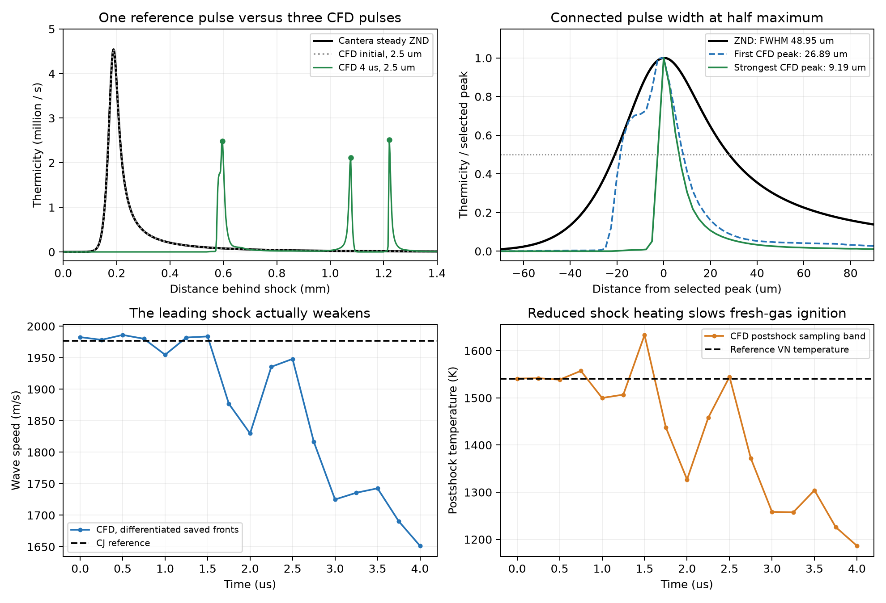

# 氢气爆轰波速偏差、诱导区与反应区宽度校验

**结论：当前瞬态 CFD 结果没有匹配 Cantera 稳态 ZND 的波速和两项区宽。最细网格的放热结构已分裂为多个峰，不能赋予其唯一的稳态诱导区和反应区宽度。波速偏低是真实的数值波减弱，并非激波定位方法造成的约 9% 假差。**

本补充分析沿用已完成的四组 4 μs 氢气–空气计算，未修改原始输入、原始场或原报告；新增三组独立算子对照并另行保存。

## 统一的区宽定义

参考与 CFD 全部使用 Cantera 3.2.0、相同 LiDryer 热化学机制，在每个保存状态的 T、p、Y 上重新计算瞬时热效应率（thermicity）：

\[\dot\sigma=\sum_k\left(\frac{\overline W}{W_k}-\frac{h_k}{c_pT}\right)\frac{W_k\dot\omega_k}{\rho}.\]

- 诱导长度：从前导激波到热效应率最大值位置的距离。
- 反应区宽度：该正热效应率峰的空间半高全宽 FWHM；两侧半高交点线性插值。它描述主要放热脉冲，不等于整个化学弛豫尾区或燃料 99% 消耗长度。
- 同一比较窗口为激波后 0–3 mm，不平滑原始剖面。峰位置取实际采样最大值，存在采样位置不确定性；半高交点使用插值。
- 参考解只有一个主峰。对多峰 CFD，按相同全局最大值规则提取一组“表观区宽”，同时报告最靠近激波的显著峰。显著峰诊断采用相对全局峰值 10% 的 prominence 门槛，不将各个分离脉冲合并为一个反应区。

定义依据为 [Caltech SDToolbox 的 ZND 模型与示例](https://shepherd.caltech.edu/EDL/PublicResources/sdt/nb/sdt_intro.slides.html#ZND-Example)及其 [znd.py 实现镜像](https://raw.githubusercontent.com/harryzhou2000/sdtoolbox/main/Python3/sdtoolbox/znd.py)。代码中实际采用 thermicity.argmax()，而不是 thermicity 梯度的最大值；本次以实现为准，并改用半高交点插值以减少采样误差。

## Cantera 参考及独立交叉检查

- 独立有限速率参考：诱导长度 **0.18844817 mm**；反应区 FWHM **0.04894813 mm**。半高上升、下降位置分别为 0.16753321 与 0.21648134 mm。
- 使用 SDToolbox 原始压力–密度 ODE、相同 D/VN 状态/机理另外积分，采样峰位置为 0.18873946 mm，按相同线性半高交点得到 FWHM 0.04893878 mm。两个峰位置使用不同采样网格，不应把末位数字差别解释成物理差异。
- 两种 ODE 实现的 0–3 mm 剖面最大差为压力 828.740 Pa、温度 0.142550 K、密度 0.000723381 kg/m³，远小于 CFD 偏差。
- 原参考积分容差收紧十倍的宽度对照保存在 width_comparison.json；不能把积分容差一致性当成峰位置无限精确，峰位置还受采样间距影响。

## 4 μs 的区宽对照

以下首先严格按窗口内最强热效应率峰提取。多峰数值场中的“诱导长度”和“反应宽度”均为瞬时表观值，不是已建立的稳态爆轰参数。

| Δx (μm) | CFL | 最强峰距激波 (mm) | 相对参考偏差 | 该峰 FWHM (mm) | 相对参考偏差 | 显著峰数 |
|---:|---:|---:|---:|---:|---:|---:|
| 10 | 0.30 | 0.395463 | +109.85% | 0.025967 | -46.95% | 1 |
| 5 | 0.30 | 0.634869 | +236.89% | 0.021597 | -55.88% | 3 |
| 2.5 | 0.30 | 1.221713 | +548.30% | 0.009191 | -81.22% | 3 |
| 5 | 0.15 | 0.472784 | +150.88% | 0.016651 | -65.98% | 3 |

为避免最强峰在不同放热脉冲之间切换造成误读，再列最靠近激波的显著峰。它是另一项辅助诊断，不能混同于上表的全局峰定义。

| Δx (μm) | CFL | 首个显著峰距激波 (mm) | 首峰 FWHM (mm) |
|---:|---:|---:|---:|
| 10 | 0.30 | 0.395463 | 0.025967 |
| 5 | 0.30 | 0.529869 | 0.016219 |
| 2.5 | 0.30 | 0.596713 | 0.026891 |
| 5 | 0.15 | 0.472784 | 0.016651 |

最细网格的三个显著峰分别位于 0.596713 mm、1.076713 mm、1.221713 mm。其中后方最强峰仅略高于首峰，机械采用全局最大值会将“表观诱导长度”跳到更远处。这正说明单一稳态 ZND 区宽已不足以描述该数值结构。即使只看首峰，位置和宽度仍明显不匹配参考。

参考放热 FWHM 在 10/5/2.5 μm 网格中分别约占 4.89/9.79/19.58 个单元。最细网格初始峰位置 0.188750 mm、FWHM 0.048978 mm，起始剖面基本一致；但终态最强次级峰 FWHM 只有约 3.68 个单元，其宽度还受空间分辨率限制。不能笼统地把初始参考区宽也称为只解析了四个单元。

## 波速为何偏低：证据与尚未解决的问题

**直接表现是放热结构畸变、多峰化与前导激波减弱，伴随激波后温度下降，后续新鲜气体反应显著变慢。当前尚未确定最初触发这种偏离的原因。**

1. **不是波前定位造成的大误差。** 最细网格分别用固定压力阈值、自适应压力阈值、密度阈值及前导激波最大压力梯度定位，2–4 μs 拟合波速均在 1792.996–1793.823 m/s，方法间差不到 1 m/s，无法解释相对 CJ 值约 184 m/s 的缺口。

2. **初始状态和基本算子没有复现这种大偏差。** 最细网格初始 T/p/u 与导入参考剖面差异极小，保存场的 EOS 密度及总能量一致性也通过。纯流动 VN 激波用同一二进制推进到 1 μs，10 μm、2.5 μm 网格波速误差分别为 +0.00375%、-0.00977%。原生 CVODE 的均匀定容点火对照计算至约 3200 K，与 Cantera 最大温差 0.409329 K、最大组分绝对差 4.820e-05。这些是有限范围的独立算子检查，不是耦合算法的完整正确性证明。

3. **反应结构的偏离先于持续的波速下降。** 最细网格在 0.25 μs 仍接近单峰参考；约 0.5 μs 已出现两个显著峰，此时波速仍接近 CJ；随后峰位置波动、后移，波前明显减弱。4 μs 时激波后采样温度约 1186.5 K、压力 1.897 MPa，低于参考 VN 的 1541 K、2.806 MPa。由晚期局部波速计算的冻结激波跳跃温度约 1181.8 K，与保存场温度相近，进一步支持“实际激波变弱”。晚期局部速度是约 0.25 μs 保存间隔上的数值微分，不能与 2–4 μs 平均速度混用。

4. **Cantera 支持强烈的温度反馈。** 用同一新鲜混合物分别从参考 VN 状态和最细网格末态激波后 T/p 状态做绝热定容计算，升温 400 K 的时间由 0.466831 μs 增至 89.669372 μs，约 192.1 倍。此试验说明温降足以显著抑制后续反应，有利于形成“激波减弱—点火延迟—放热离激波更远”的反馈。该定容时间不是实际 CFD 的质点诱导时间，也不是已经证明了全部因果链。

**剩余不确定性：** 现有数据和对照将问题范围收窄到激波捕捉与化学反应的耦合演化，以及近 CJ 解对扰动的响应。它们仍不能区分分裂/空间离散误差触发或放大，与连续方程本身的爆轰不稳定性。减半 CFL 未恢复稳态匹配；这不等于已经完成时间收敛。需要进一步的稳定性或不同耦合算法对照，才能把最初触发源归因到具体实现。

主算例的粗网格比较窗口尾部仍有原报告注明的边界影响不确定性；最细网格保存场特征速度估计的边界余量约 1.74 mm。以上算子对照均使用独立目录，没有改写原算例。

## 图与证据

- results/final_width_metrics.csv：四组终态主峰与首峰区宽。
- width_history.csv、width_comparison.json：全部保存时刻的宽度、峰数量、热效应率、激波后状态和初始化/EOS 检查。
- operator_probe_results.json：三组正常完成的独立算子对照、Cantera 定容敏感性、冻结激波跳跃核查。
- shock_estimator_check.json：四种激波定位方法的完整时间历史与拟合。
- reference_crosscheck.json、sdt_crosscheck_profile.npz、vendor/：第二套 SDToolbox ODE 的结果和原始源码；来源及 SHA-256 单独记录。
- hydro_only_*_v2、chemistry_only_v1：正式对照输入、日志、退出码和运行二进制哈希。两组 hydro_only_*_v1 已完成物理终止时间，但因四个未使用的化学参数触发严格输入检查而退出码为 6；保留失败证据，不用于正式对照结论。删除这些无效参数后在 v2 独立目录重跑，仍保留严格输入检查。
- 新增对照原始场另行归档；原四组反应流的全部原始场仍见此前 hydrogen_znd_evidence_final_v3.zip。

