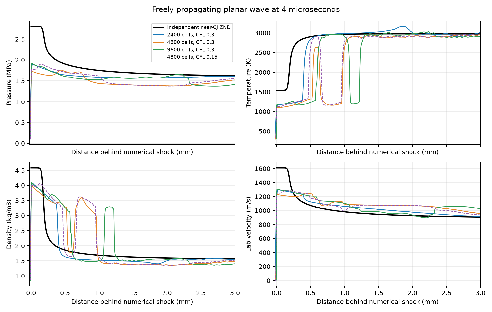
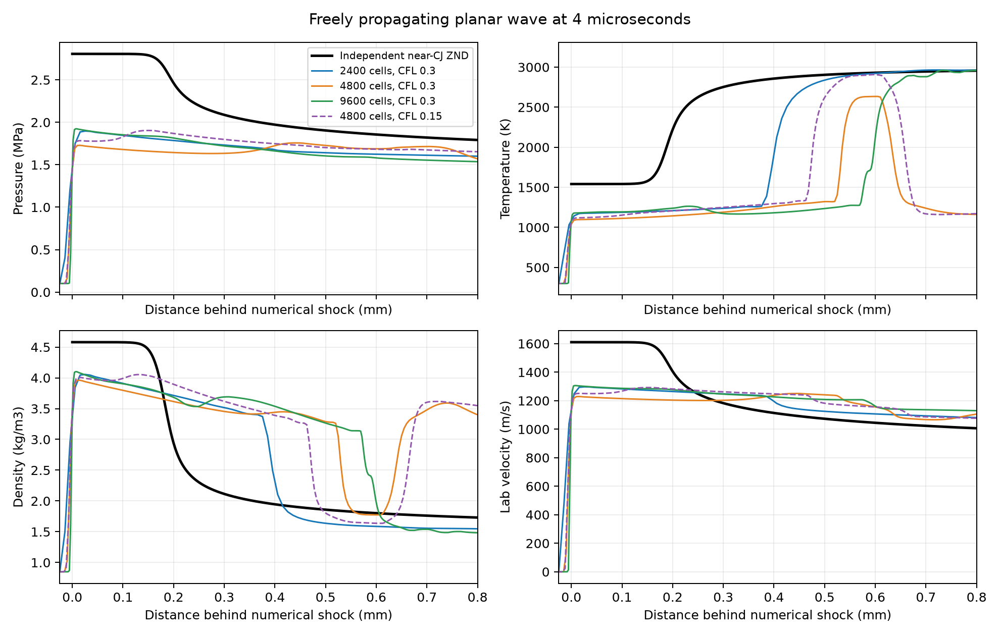
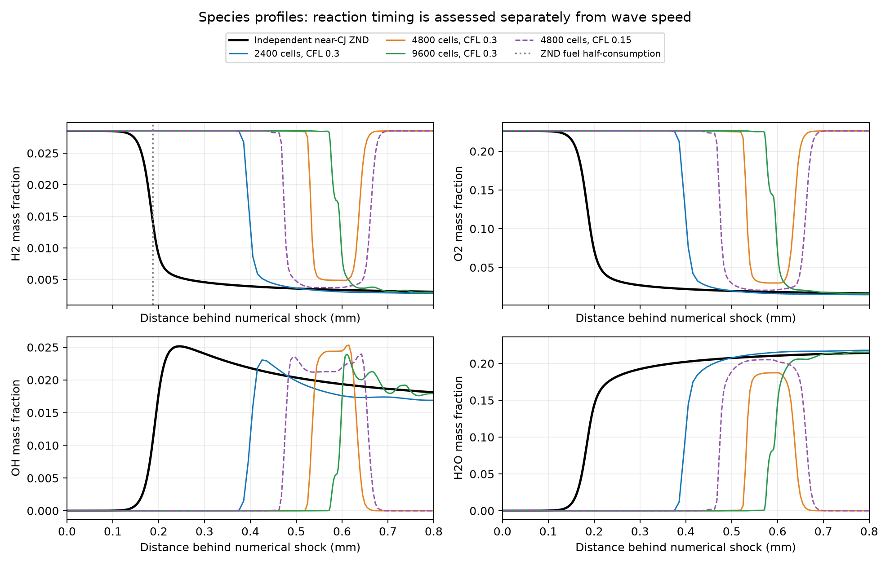
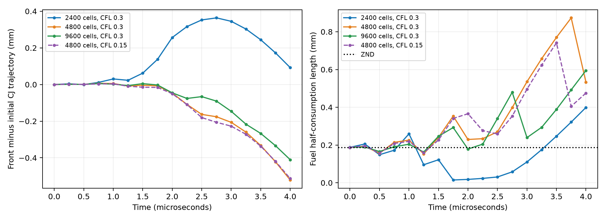

# 氢气–空气 ZND 数值验证报告

**结论：未通过本次近 CJ 稳态 ZND 保持验证。** 四组正式算例均运行到 4 μs 后正常退出。正常结束、守恒及组分有界性与稳态 ZND 匹配是不同的检验项目，以下分别报告。

## 算例与比较方法

- 上游：H₂:O₂:N₂ = 2:1:3.76（摩尔比），当量比 1，300 K，101325 Pa。
- 化学：PelePhysics LiDryer，9 组分、21 个可逆反应。重新构建独立 CPU 可执行文件，使用原生 PeleC 流动推进和 CVODE 化学积分；不修改共用求解器源代码。
- 模型：无黏单相反应 Euler；24 mm × 0.2 mm 周期窄条，横向 2 单元，轴向 2400/4800/9600 单元，空间步长 10/5/2.5 μm；无 AMR、无喷雾、无扩散。
- 时间：三档网格采用 CFL 0.30；另在 5 μm 网格采用 CFL 0.15。CVODE 相对/绝对容差为 1e-8/1e-18。每组使用 16 个 MPI 进程。
- 初始化：激波位于 x = 8 mm，下游使用独立有限速率 ZND 剖面，初始波速为 1.00001 倍 CJ 波速，以避开严格 CJ 尾端奇异点。初始化后不强制波速。
- 以压力跨越上游与 VN 压力中值的位置定位前导激波。波速由 2–4 μs 的波前位置线性拟合得到，另列 3–4 μs 拟合值检查非定常性。
- 最终剖面均按数值激波位置对齐，在同一物理窗口 ξ = 0.05–3 mm 比较；ξ 为激波后距离。压力、温度、密度、实验室系速度的平均绝对误差分别除以参考压力跃升、参考最高温度与上游温差、参考密度跃升和初始参考波速。组分误差直接使用质量分数平均绝对误差。
- 半消耗长度是沿激波向下游遇到的第一个 Y(H₂) = 0.5Y₀(H₂) 位置；温升半程是温度首次达到 VN 温度与参考剖面尾端温度中值的位置。均采用线性插值。

## 独立参考解和热化学一致性

- CJ 波速：1977.04236268 m/s；初始 ZND 波速：1977.06213310 m/s。VN 压力 2.80579525 MPa，温度 1540.985538 K。
- 氢气半消耗长度 0.187058950 mm，对应流体质点停留时间 0.497409083 μs；温升半程 0.202160080 mm，对应 0.525434110 μs。
- 沿参考解到 ξ = 3 mm 的质点停留时间为 3.330324 μs，小于 4 μs 总时长。这是参考解给出的换流时间估计，并非数值流场的示踪粒子证明。
- CJ 声速条件相对误差 1.564e-08；参考解最大总能量守恒相对残差 2.383e-09。积分相对容差从 2e-9 收紧到 2e-10 后，0.05–3 mm 内温度剖面最大变化 1.865e-05 K。
- Cantera 在 CJ 平衡态的最大 |dY/dt| 为 6.498e-09 s⁻¹；绝热定容继续积分 100 μs，温度变化 -9.095e-13 K。
- 直接编译原生机制头文件，在 307 个 ZND 状态与 Cantera 比较：比热最大绝对差 2.274e-12 J/(kg·K)，内能最大绝对差 2.619e-09 J/kg；摩尔生成速率最大绝对差除以全样本速率峰值为 1.168e-05，逐状态按当地速率峰值归一化的最大差为 8.137e-04。没有把速率差异表述为严格为零。
- 该混合物的平衡解含剩余氢气，因此参考解中“99% 初始燃料消耗位置”为 null；这不是参考解积分失败。

## 四组正式计算结果

| Δx (μm) | CFL | 波速 2–4 μs (m/s) | CJ 偏差 | 波速 3–4 μs (m/s) | 氢气半消耗长度 (mm) | 长度偏差 |
|---:|---:|---:|---:|---:|---:|---:|
| 10 | 0.30 | 1885.965 | -4.607% | 1722.762 | 0.399071 | +113.34% |
| 5 | 0.30 | 1759.710 | -10.993% | 1660.652 | 0.533247 | +185.07% |
| 2.5 | 0.30 | 1792.996 | -9.309% | 1718.935 | 0.595041 | +218.10% |
| 5 | 0.15 | 1766.519 | -10.648% | 1689.412 | 0.475261 | +154.07% |

| Δx (μm) | CFL | p 归一化 L1 | T 归一化 L1 | ρ 归一化 L1 | u 归一化 L1 | 温升半程偏差 |
|---:|---:|---:|---:|---:|---:|---:|
| 10 | 0.30 | 6.395% | 6.089% | 5.884% | 3.367% | +103.27% |
| 5 | 0.30 | 10.980% | 17.249% | 13.558% | 6.409% | +167.08% |
| 2.5 | 0.30 | 8.433% | 13.588% | 10.737% | 4.673% | +198.14% |
| 5 | 0.15 | 9.417% | 14.864% | 12.591% | 5.570% | +138.46% |

| 检查项 | 结果 |
|---|---|
| 参考 CJ 声速条件（< 1e-6） | 通过 |
| 参考能量残差（< 1e-7） | 通过 |
| 最细网格平均波速相对误差 < 1% | 未通过 |
| 最细网格 p/T/ρ/u 归一化 L1 均 < 5% | 未通过 |
| 最细网格 H₂/O₂/OH/H₂O 质量分数 MAE 均 < 0.005 | 未通过 |
| 最细网格氢气半消耗长度相对误差 < 10% | 未通过 |
| 最细网格温升半程相对误差 < 10% | 未通过 |
| 全部原始输出场无 NaN/Inf | 通过 |
| 全部算例组分和偏差 < 1e-8 | 通过 |
| 全部正式算例运行到 4 μs 且退出码为 0 | 通过 |

流动、组分和反应长度的目标在正式矩阵开始前写入 validation_scope.json。参考声速和能量阈值是额外的参考质量诊断。0.05–0.5 mm 反应区误差另存 metrics.csv 的 core 列，不替换事先指定的比较窗口。

## 非定常性、时间步与守恒

- 在最细网格，2–4 μs 与 3–4 μs 拟合波速分别为 1792.996 与 1718.935 m/s；结合下方波前及反应长度历史判断非定常程度，不能用全时段平均波速掩盖后段变化。
- 在同一 5 μm 网格，CFL 从 0.30 改为 0.15 后，2–4 μs 拟合波速变化 +6.808 m/s，最终氢气半消耗长度变化 -0.057986 mm。完整同窗口剖面差异见 assessment.json。
- 四组算例最大的质量守恒残差/初始库存为 2.048e-10，总能量守恒残差/初始库存为 6.346e-08。残差已扣除两端边界净通量；时间积分采用保存时刻上的梯形公式。
- 最大组分和偏差为 1.568e-13；所有保存场的 NaN/Inf 计数为 0，横向相对差异最大值为 0.000e+00。
- 另外用相同设置分别在横向 2/4 单元推进 40 步，时间差 0.000e+00 s，逐场横向平均值的最大相对差为 0.000e+00。这只验证短时横向离散等价性。

边界影响估计：用全部保存场的最大 |u|+c（冻结声速）乘以总时长，检查左边界特征传播范围是否覆盖最终比较窗口；这是保存数据上的估计，不是连续时间的严格证明。

| Δx (μm) / CFL | 最大保存特征速度 (m/s) | 左边界预计影响范围 (mm) | 比较窗口左边界 (mm) | 剩余距离 (mm) |
|---|---:|---:|---:|---:|
| 10 / 0.30 | 3327.39 | 13.310 | 13.000 | -0.309 |
| 5 / 0.30 | 2644.69 | 10.579 | 12.387 | 1.809 |
| 2.5 / 0.30 | 2689.99 | 10.760 | 12.498 | 1.738 |
| 5 / 0.15 | 2664.32 | 10.657 | 12.395 | 1.738 |

10 μm 粗网格的该保守估计覆盖最终比较窗口尾部约 0.309 mm，因此本次不能用这项估计排除其尾部边界影响；5 μm、2.5 μm 及减半时间步算例仍有约 1.74–1.81 mm 的估计余量。这项限制不改变最细网格未满足目标的判定。

## 解释范围

本次验证检验的是原生 CPU 单相、无黏、平面近 CJ 波能否维持并匹配给定的稳态 ZND 结构。若波速、反应长度与剖面目标未满足，就不能据此宣布 ZND 验证通过。正常退出及守恒通过也不代替这些目标。

观察到的波前和反应区变化本身不能单独证明存在程序错误，也不能单独证明是物理爆轰不稳定性：激波捕捉误差、反应–流动分裂误差以及近 CJ 解对扰动的放大仍需区分。三档有限网格和一次时间步减半不足以完成线性稳定性或渐近收敛论证。本报告保留所有未通过项，不通过修改验收阈值或选择某个时刻来宣称成功。

本结果不验证 GPU、喷雾、多相耦合、扩散、AMR、二维胞格结构或其他化学机理，也不覆盖长期传播稳定性。若进一步定位原因，可先做独立的一维稳定性分析及更细网格/更小分裂步长对照，再用较强过驱动的平面 ZND 波作补充验证。

## 图与可复现证据

- results/metrics.csv、results/assessment.json：完整误差、目标判定、网格和时间步差异。
- 各 case/inputs、case.json、run.log、exit_code、timing.json 与 analysis/：实际输入、二进制及初始化数据 SHA-256、正常退出证据、原始时间历史及提取剖面。
- reference_v1、reference_tight_v1、reference_quality.json：独立 CJ/ZND 参考与收紧积分容差对照。
- native_rates.cpp、native_rates_build.json、audit_native_rates.py：直接调用原生机制热化学的独立比对；source_snapshot、source_manifest.json、git_revisions.json 与 build_source：相关源码快照、版本和构建证据，含实际运行的二进制。
- native_plotfile_manifest.json：全部正式及横向短时对照原生 plotfile 的逐文件 SHA-256。原始场归档位于 ZIP 的 native_plotfiles/，分析报告及脚本位于 evidence/。

归档完成后另行记录 ZIP 大小、SHA-256、CRC 检查结果，并在本地解包后逐一核验所有原生场文件。
