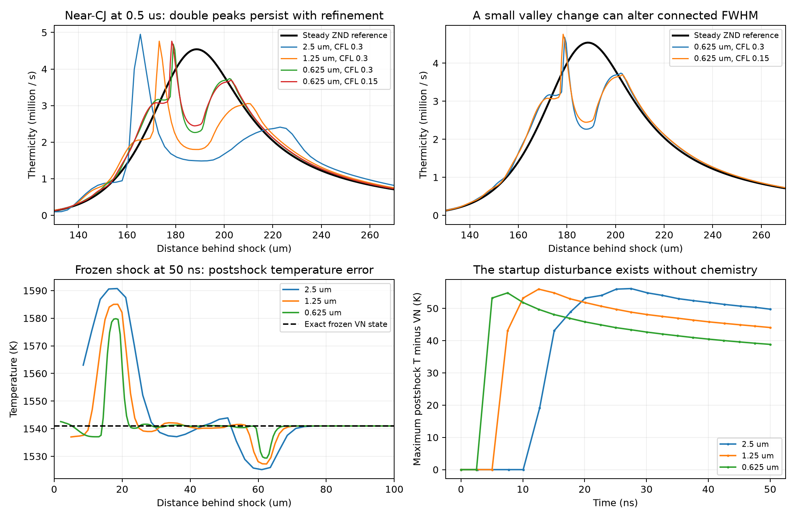
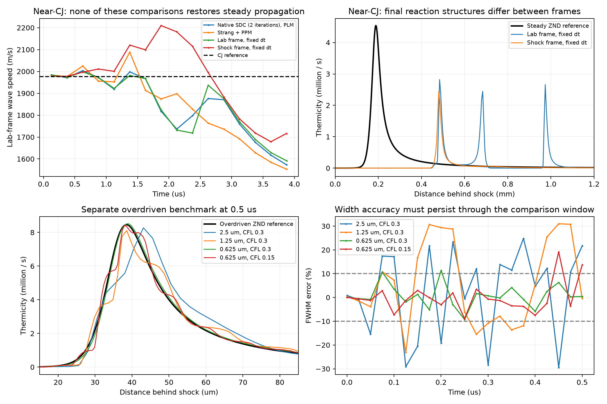

# 一维爆轰基础核验与耦合问题排查

**当前一维验证尚未整体通过，现有二维结果不能据此获得定量可信度。近 CJ 对照仍有显著偏差；过驱动基准也必须通过减半时间步检查，不能用单个较好结果代替整个矩阵的验收。新增对照已经排除“只改 Strang 或只升阶就能恢复”的简单判断，但最初偏离源尚未完全确定。**

本次区分三件事：独立热化学和非反应激波算子是否正确、指定稳态参考能否被耦合求解器保持、近 CJ 自由演化波是否具有真实不稳定性。每一层的通过范围单独限定。

## 近 CJ 对照的完成结果

条件为当量比 1 的氢气–空气、300 K、101325 Pa、LiDryer 9 组分机制；参考 CJ 速度 1977.042 m/s。以下均为 5 μm 网格，推进到 4 μs；波速取 2–4 μs 拟合，并统一换算到实验室坐标。

| 对照 | 平均波速 (m/s) | 相对初始化 ZND 速度偏差 | 终态主峰距激波 (μm) | 终态主峰 FWHM (μm) |
|---|---:|---:|---:|---:|
| Native SDC (2 iterations), PLM | 1756.944 | -11.134% | 967.684 | 15.585 |
| Strang + PPM | 1708.513 | -13.583% | 1061.063 | 13.173 |
| Lab frame, fixed dt | 1763.633 | -10.795% | 484.110 | 16.994 |
| Shock frame, fixed dt | 1870.513 | -5.389% | 480.416 | 20.627 |

原近 CJ 参考的诱导长度为 188.448 μm，热效应率峰 FWHM 为 48.948 μm。多峰数值场的表观区宽不能作为已经建立的稳态 ZND 参数。

- 原生 SDC 使用 2 次迭代；默认 SDC 迭代数是 1，不能把默认值称为配置错误。本次 SDC 与新增 Strang 的差异是受控对照，原有已修改框架不等于未经修改的上游 PeleC。
- PPM 对照只改变空间重构，保留原 Strang、化学容差和 CFL。两种改动都未消除近 CJ 波衰减。
- 坐标系对照使用同一新二进制、同一网格、同一时间步序列；首步 0.1 ns，随后固定 0.5 ns，末步截断。新程序零平移时与旧程序 40 步的全部输出场逐值一致。
- 平移同时作用于未燃气和已燃气速度，动量、总能量重新按该坐标系构造。参考比较使用 u_lab=u_grid+U_frame、D_lab=D_grid+U_frame，守恒计算仍用网格坐标系的动能与能流。没有施加持续的波速强制。
- 两个坐标系的离散结果具有显著差异，且两者均未维持稳态参考。这是有限网格的敏感性证据；不能仅据此断定连续方程没有物理不稳定性，或断定 Strang 实现有某个已定位的错误。

静止波坐标下的全域边界收支采用每 0.25 μs 保存的边界状态作梯形积分。末期出流快速变化，质量/能量相对初始库存的估算残差约 2.07×10⁻⁴/4.79×10⁻⁴；这项稀疏采样预算未达到严格守恒验收精度，不能把它当作精确逐时间步通量审计。反应核心区的左右边界特征线估算仍有正余量，详见各 case 的 thermicity.json。

## 独立的过驱动短时基准

使用 D=1.2 D_CJ=2372.451 m/s 的 ZND 解及其后方支持流初始化，域长 3 mm、初始波前 1 mm，正常推进到 0.5 μs。它是额外的稳态保持测试，不代表近 CJ 自持爆轰验证通过。参考诱导长度 38.531 μm，FWHM 16.731 μm；参考最高温度约 3358 K。参考质量、动量、能量不变量也独立检查。

过驱动剖面误差在激波后 5–200 μm 的固定核心区比较，归一化采用固定参考跳跃幅度；与近 CJ 的 50–500 μm 窗口区分记录。波速拟合窗口为 0.25–0.5 μs。

| Δx (μm) | CFL | 波速偏差 | 终态诱导长度 (μm) | 终态 FWHM (μm) | 后半段最大区宽误差：诱导/FWHM | 短时逐项检查 |
|---:|---:|---:|---:|---:|---:|---|
| 2.5 | 0.3 | -0.146% | 43.086 | 20.364 | 17.49% / 29.41% | 有检查未通过 |
| 1.25 | 0.3 | -0.192% | 38.582 | 16.654 | 17.08% / 30.98% | 有检查未通过 |
| 0.625 | 0.3 | -0.108% | 38.587 | 16.799 | 6.52% / 9.24% | 通过所列检查 |
| 0.625 | 0.15 | -0.104% | 38.011 | 19.023 | 6.27% / 19.16% | 有检查未通过 |

所列检查包括：平均速度误差≤1%，后半段每次输出的诱导长度与 FWHM 误差≤10%，四项核心流场归一化 L1≤5%，单一主峰、有限场、组分和、边界到核心区的估算余量以及边界收支。完整布尔项及所有误差保存在 verification_status.json。

三档网格的后半段平均核心区误差如下；必须同时看空间误差变化和减半时间步敏感性，不能只用末态波速接近作判据。

| 量 | 2.5 μm | 1.25 μm | 0.625 μm | 每档细化均下降 |
|---|---:|---:|---:|---|
| rho 归一化 L1 | 0.014094 | 0.008558 | 0.004482 | True |
| p 归一化 L1 | 0.008744 | 0.004478 | 0.002275 | True |
| T 归一化 L1 | 0.011050 | 0.007242 | 0.003695 | True |
| u 归一化 L1 | 0.004139 | 0.002202 | 0.001093 | True |

最细网格 CFL 从 0.3 减为 0.15，平均波速变化为参考速度的 0.00372%，终态诱导长度/FWHM 变化为相应参考长度的 1.495%/13.293%。

**短时基准的边界：** 此处仅测试 0–0.5 μs 的平面、无黏、单相 LiDryer/CVODE CPU 路径。它不证明长时间稳定性、其它燃料机理、GPU 路径或二维胞格结构正确，也不能反向将近 CJ 失败算例改标为通过。

## 近 CJ 早期网格细化与初始表插值对照

另取同一近 CJ 初始参考，在长 3 mm、初始波前 1 mm 的域内计算前 0.5 μs，比较激波后 50–500 μm 核心区。每个短域均单独核对边界特征线估算余量。初始表加密对照只将参考导出由 5001 点增至 50001 点，保持 ODE、容差、波速、网格、流动和化学设置不变；所有区宽仍相对同一原参考比较。

| 算例 | 波速偏差 | 0.5 μs 主峰位置 (μm) | 主峰 FWHM (μm) | 终态显著峰数 | 后半段最大诱导/FWHM 误差 |
|---|---:|---:|---:|---:|---:|
| 2.5 μm / CFL 0.3 | -0.0456% | 165.484 | 10.614 | 2 | 18.01% / 78.32% |
| 1.25 μm / CFL 0.3 | -0.0175% | 173.258 | 8.170 | 2 | 14.64% / 83.31% |
| 0.625 μm / CFL 0.3 | -0.0066% | 179.046 | 20.322 | 2 | 11.30% / 58.48% |
| 0.625 μm / CFL 0.15 | -0.0036% | 178.420 | 50.950 | 2 | 11.31% / 13.28% |
| 1.25 μm / CFL 0.3 / 加密初始表 | -0.0179% | 173.256 | 8.171 | 2 | 14.64% / 83.31% |

早期表观区宽与峰数量需要结合完整热效应率剖面解释。峰间谷值跨过半高时，连通半高宽可能突变，因此不能只用一个 FWHM 数字判定收敛或给多峰结构赋予唯一稳态反应宽度。更细网格、较短运行或某一时刻更接近参考，都不能单独证明原 4 μs 演化正确。

补充整体热效应率剖面检查：相对参考绝对积分归一化的 0.5 μs 剖面 L1 误差，在 2.5/1.25/0.625 μm 网格上约为 36.34%/21.89%/12.06%，说明整体形状随细化改善，但最细结果仍存在结构偏差。最细网格减半 CFL 时，两条热效应率曲线之间的同类 L1 差异约 1.66%；连通 FWHM 从 20.32 μm 跳到 50.95 μm，不能解释成整个反应区发生同等倍数变化。过驱动两条最细网格曲线的同类时间步差异约 6.28%，其单峰 FWHM 仍未通过时间步核对。

## 激波启动误差的独立证据

用相同二进制关闭全部化学，初始化满足冻结 Rankine–Hugoniot 条件的单一移动激波，并用三档网格记录前 50 ns。在激波后 3Δx 至 100 μm 的区域内，仍发现约 55–56 K 的最大温度误差。包括数值激波单元时最高温度约 1616 K，而精确 VN 温度约 1541 K。冻结问题没有化学不稳定性，因而该启动扰动属于数值流动误差；它不能由此前仅检验平均波速的纯流动测试排除。

这里报告的是保存时刻上的最大误差。细化网格并未让这一局部最大值按整体流场误差的比例下降，必须同时检查扰动的宽度、持续时间及其对点火的影响。它为“激波捕捉产生启动扰动”的判断提供了证据，但还没有证明该扰动足以独自解释 4 μs 的全部减速。

加密初始表对照保留几乎相同的双峰：在 1.25 μm 网格下，原表/加密表的终态主峰 FWHM 约为 8.1699/8.1714 μm。因此初始表采样粗糙不是这一尖峰的主要来源。

固定初始 VN 压力下，新鲜混合物的绝热定容升温 400 K 时间，在 VN 温度下约为 0.4668 μs；温度增加 55 K 后约为 0.3765 μs，缩短约 19.4%。这是独立温度敏感性试验，不是 CFD 实际质点历程，完整结果见 startup_temperature_sensitivity.json。

进一步按保存的速度场重建启动热气团的近似轨迹，得到半燃料消耗时刻相对匹配初始质点年龄的 ZND 参考提前约 8–13%。但该气团在 0.5 μs 的位置约为波后 212 μm，与前方尖峰的 165–179 μm 位置不重合。因此不能将“启动热气团”等同于“前方尖峰”，也不能仅凭位置接近就宣称完整因果链已证实。这些轨迹受 25 ns 输出间隔和有限体积数值扩散影响，属于运动学辅助证据，不是原生守恒示踪标签。见 startup_packet_paths.json 与 startup_packet_ignition.json。

## 目前最有依据的判断

1. 初始参考、单位或独立化学算子的严重错误优先级已降低。此前同二进制纯流动 VN 激波速度误差约 0.01% 以内，均匀定容点火与 Cantera 最大温差约 0.41 K；有限速率参考也与另一套 SDToolbox ODE 做过核对。这些局部检查不等于耦合正确性。
2. 优先怀疑激波启动/捕捉误差与刚性反应的耦合放大：纯流动对照已找到局部温度扰动，近 CJ 早期双峰随细化逐渐靠拢但未消失；原生 SDC、PPM、坐标系变化都没有恢复近 CJ 稳态。扰动的产生已证实为数值现象，其是否以及如何触发后续全部波衰减仍需进一步的因果对照。
3. 以未经稳定性证明的近 CJ 自由演化波，在单个短窗口内必须保持稳态 ZND，作为唯一耦合验收条件，本身不充分。氢气–空气一维爆轰可以具有不同脉动模式，且与支持程度有关；相关研究提供这一可能性的依据，但不是本算例物理不稳定性的证明。[Romick 等，JFM 2015](https://doi.org/10.1017/jfm.2015.114)。
4. 原有二维图像中的波形或胞格外观不足以建立定量可信度。近 CJ 时间历程的空间/时间收敛、稳定性判别和更长时间验证仍是未完成事项。

## 交付证据

- results/verification_status.json：完成状态、逐项检查、误差和收敛对照。
- results/case_metrics.csv：各算例波速与表观区宽。
- 每个算例的 inputs、case.json、run.log、exit_code、analysis/：精确参数、二进制哈希、运行结果和完整时间历史。
- frame_build_source/ 与 frame_build_command.json：坐标平移初始化源码及独立完整构建记录；零偏移对照另存。
- reference_overdrive_1p2/：独立 ZND 参考表和守恒不变量检查。
- thermicity_common.py、analyze_thermicity_cases.py：所有参考和数值场使用同一定义、同一机制重新计算热效应率，区宽不由不同的 heatRelease 输出语义混算。
