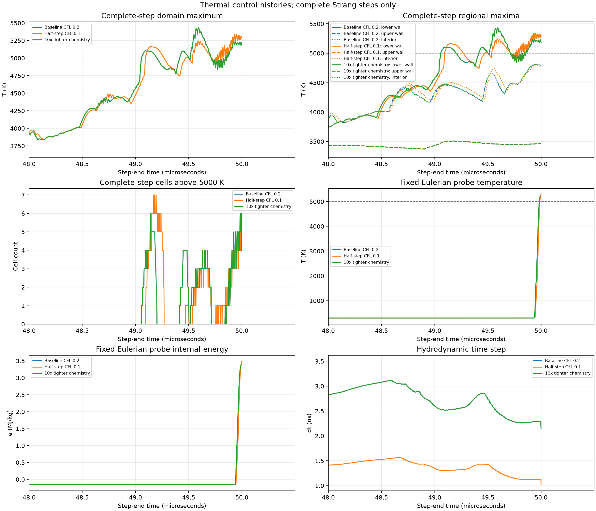
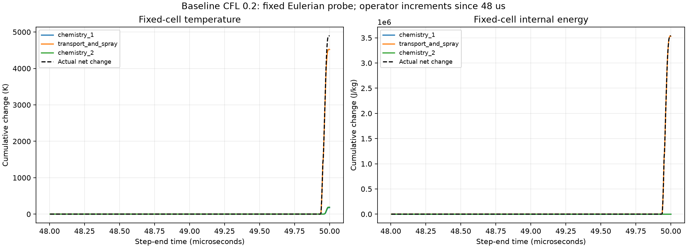
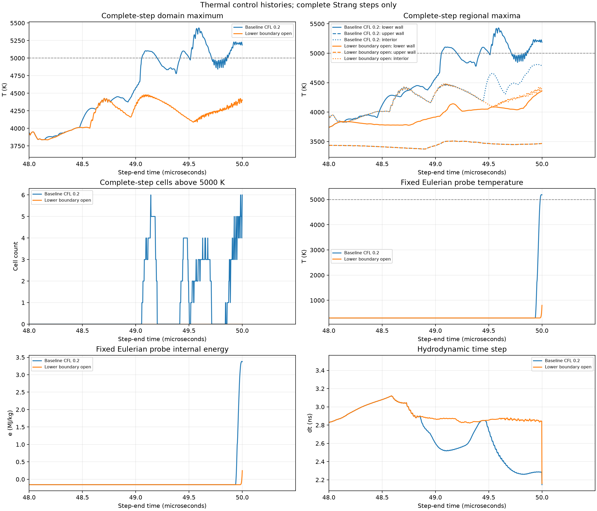
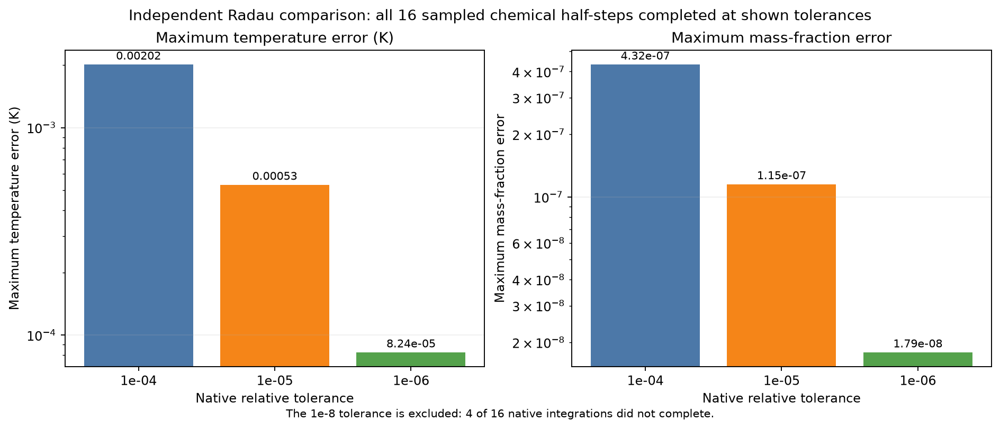
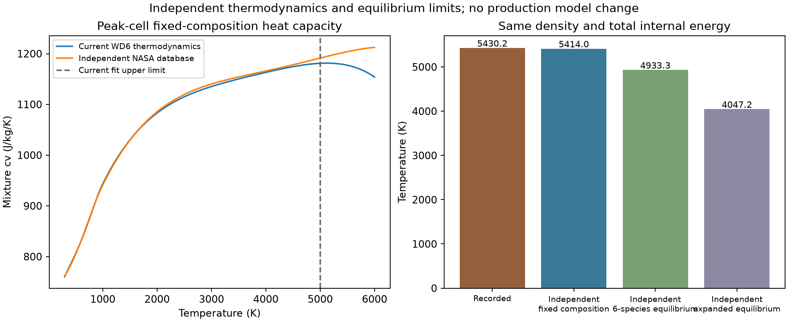
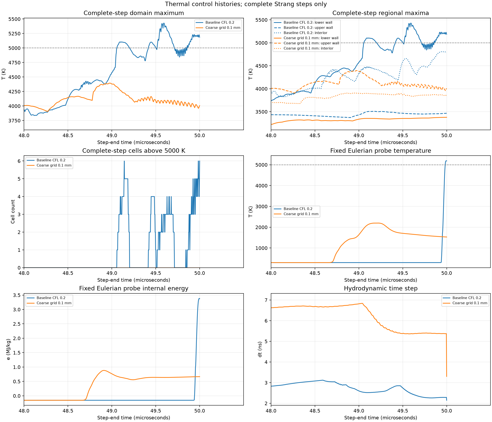
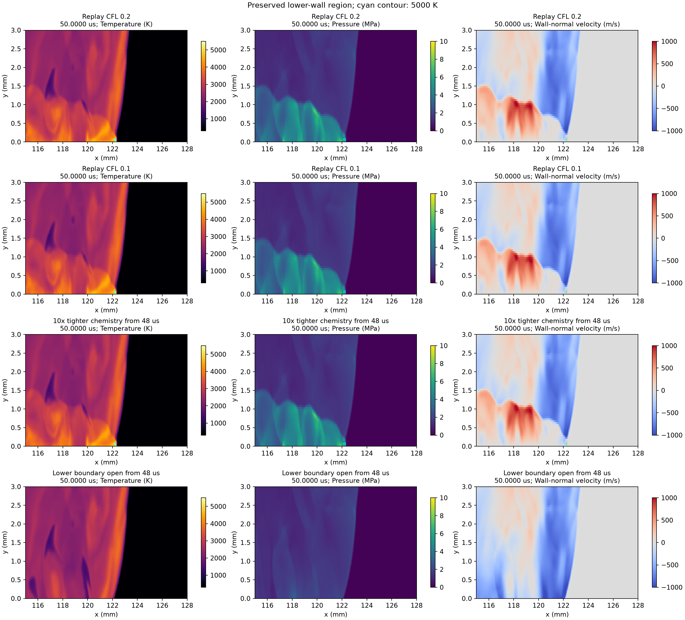

# 两相爆轰温度超限诊断报告

本轮已完成五个流动对照至 50 μs，并完成 16 个热点状态的独立化学积分核对。**原滑移壁算例的温度超限仍未解决，不能将这一轮诊断标为物理验证通过。** 这里的“超限”指超过原热力学数据的 5000 K 拟合上限，并不是先验设定的物理温度上限。

已获得的结论是：原峰值可以重现；时间步约减半和化学积分容差收紧均不能消除超限；热点位于下壁附近，并对下壁条件敏感；仅更换适用于更高温度的热力学系数也不足以让峰值降至 5000 K 以下。高温化学完整性和空间分辨率仍需进一步验证。

## 1. 对照结果

| 对照 | 全部记录分步中的峰值 / K | 50 μs 峰值 / K | 50 μs 超限单元数 | 首次超限所属步终点 / μs |
|---|---:|---:|---:|---:|
| 细网格基准 | 5430.183 | 5186.768 | 6 | 49.058124 |
| 时间步约减半 | 5342.986 | 5290.357 | 4 | 49.093442 |
| 化学积分容差收紧 10 倍 | 5430.204 | 5186.770 | 6 | 49.058123 |
| 下壁改为开放边界 | 4488.094 | 4398.276 | 0 | 未出现 |
| 粗网格对照 | 4394.798 | 4006.522 | 0 | 未出现 |

“全部记录分步”包括反应第一半步、输运与喷雾耦合步和反应第二半步。中间分步是算子分裂状态，不应视为额外采样的真实连续物理时刻。首次超限时间统一标为所属完整时间步终点。

细网格为 2800×800，间距 0.05 mm；粗网格为 1400×400，间距 0.1 mm。基准与减半时间步均由同一个约 40 μs 的细网格检查点重放至 50 μs。开放下壁、收紧化学容差两个对照由同一个约 48 μs 的基准检查点分支；粗网格从自身独立演化至约 40 μs 的检查点重放。因此粗细网格比较还包含先前轨迹及粒子分辨率差异，不是同一瞬时状态的纯离散截断误差测试。

除所列对照参数外，细网格计算保留原 WD6 机理、化学浓度正则化、喷雾和初始物理模型。五个已完成算例均正常退出，记录中未出现非有限温度；这些数值运行状态不代表高温物理模型已通过验证。

完整数值见[温度历史汇总](final_history_summary_v1.json)；实际输入、命令与二进制散列保存在各算例的 inputs 和 case.json 中。

## 2. 热点形成与近壁作用

基准首次超限出现在下壁第一层单元，中心位置为 x=119.125 mm、y=0.025 mm，所属步终点约 49.058124 μs。该步四个分步的最大值均落在同一个单元，因此可以比较该次事件的同单元变化：第一化学半步升温约 0.104 K，输运与喷雾分步升温约 14.682 K，第二化学半步升温约 0.956 K。输运分步中密度和守恒内能同时增加。

减半时间步首次超限仍在下壁第一层附近，约 49.093442 μs；该事件中两个化学半步分别升温约 11.352 K 和 9.534 K，输运分步约 6.758 K，直到第二化学半步才越过 5000 K。由此不能把“首次跨越阈值的分步”概括为所有参数下唯一相同的原因。

基准全过程最高的分步温度约 5430.183 K，出现在 x=119.475 mm、y=0.025 mm 的输运与喷雾分步。壁面敏感性、事件位置以及输运和反应共同升温的证据，支持继续检查近壁波相互作用及高温化学响应；目前尚未将压力功、对流搬运与数值耗散逐项独立分离，不能把输运分步的内能增加全部称为压缩功。

固定探针位于原 50 μs 热点单元 x=122.225 mm、y=0.075 mm。在基准 48–50 μs 内，它从约 300.005 K 升至 5186.768 K，累计分步温差分别为化学第一半步约 176.792 K、输运与喷雾分步约 4518.982 K、化学第二半步约 190.989 K。这是欧拉固定单元的算子变化账目，包含热流体进入和离开，不是跟随一团气体的热量预算，也不能据此给出燃烧热与压缩热的物理百分比。

将下壁由滑移壁改为开放边界后，本次 48–50 μs 对照未超限，记录峰值为 4488.094 K。该改动同时改变气体边界和粒子反射/逸出条件，属于物理边界敏感性试验。若原几何确实存在固壁，就不能采用这项改动来宣称原问题已修复。

首次事件原始状态见[基准事件](baseline_first_event_v1/event_summary.json)和[减半时间步事件](half_first_event_v1/event_summary.json)。

## 3. 积分误差核对

对基准和减半时间步的首次超限、峰值、末步以及高温化学升温事件选取了 16 个同单元化学半步。使用实际 WD6 C++ 积分器，与独立实现的两个反应进度变量 SciPy Radau 积分比较；后者单独实现 NASA7 热力学反算，并保持同一密度、总内能、机理和浓度正则化。

| C++ 相对容差 | 完成数/请求数 | 已完成端点最大温差 / K | 最大组分质量分数差 |
|---|---:|---:|---:|
| 1e-04 | 16/16 | 0.00201516 | 4.3248e-07 |
| 1e-05 | 16/16 | 0.000529769 | 1.15079e-07 |
| 1e-06 | 16/16 | 8.24331e-05 | 1.7905e-08 |
| 1e-08 | 12/16 | 6.20377e-07 | 1.34556e-10 |

默认容差 10⁻⁴ 的 16 个状态全部完成，最大温差约 0.002 K；CPU 同一算法与已记录 GPU 化学分步的温度差仅在约 10⁻¹² K 量级。独立参考进一步收紧自身容差后结果稳定。因此这些热点状态的化学积分误差不足以解释数百 K 的超限。该结论只覆盖所采样半步，不能替代整个耦合流动的误差界或机理适用性验证。

10⁻⁸ 容差下有 4 个局部积分达到 20000 次尝试上限，未得到完整端点；报告的误差统计只包含完成的 12 个端点，并未把失败项计为通过。

另一个全场“收紧 100 倍”试验在 48.092397 μs 被主动终止，原因是计算成本过高；其非零退出、终止记录和所有已有输出完整保留。它没有完成所需时间区间，不参与已完成流动对照结论。后续采用收紧 10 倍的完整对照验证敏感性。

参见[独立积分汇总](hot_cell_chemistry_validation_v3/validation_summary.json)、[原始核对结果](hot_cell_chemistry_validation_v3/validation.json)和[中止记录](tight_chemistry_from48_v1/termination_record.json)。

## 4. 热力学范围与高温化学

独立参考采用 Cantera 附带的 NASA TM-4513 气相数据，相关物种拟合范围为 200–6000 K。保留实际守恒场中的密度、组分及内能，重新反求温度，得到：

| 状态 | 原记录 / K | 独立热力学、固定组分 / K | 六组分受限平衡 / K | 十六组分受限平衡 / K |
|---|---:|---:|---:|---:|
| 原 50 μs 保存场峰值 | 5186.768 | 5174.268 | 4684.796 | 3824.630 |
| 重放过程瞬态分步峰值 | 5430.183 | 5414.045 | 4933.320 | 4047.218 |

固定组分的独立温度仍超过 5000 K，因此原热力学拟合的外推差异不是数百 K 超限的充分解释。原能量反求温度程序在 5000 K 以上采用边界比热线性延拓，而热力学性质函数仍求值原多项式；两个峰值的线性反算与多项式反算差约为 0.038 K、0.120 K，也不足以解释超限。

六组分与十六组分平衡的差别说明，允许解离及自由基等高温物种后，可用化学自由度明显改变热力学结果。但十六组分仍是有限集合，平衡计算不含局部有限反应时间；其温度不能替换实际非定常单元温度，也不证明增加这些物种后流动峰值必然降到表中数值。WD6 的经验 CO 正逆反应也不保证严格满足热力学平衡常数。

数据与散列见[热力学核查](baseline_peak_thermodynamics_v2/assessment.json)和[反算程序证据](thermodynamic_inverse_source_evidence.json)。数据库来源：[Cantera NASA 气相数据库](https://github.com/Cantera/cantera/blob/main/data/nasa_gas.yaml)、[NASA TM-4513](https://ntrs.nasa.gov/citations/19940013151)。

## 5. 超限规模、网格与波前

下面统计限定在 48–50 μs，采用完整时间步终点值的矩形积分；“有超限的持续时间”是包含至少一个超限单元的时间步时长之和，可能包括多个不连续区段。内部区域排除上下各 0.5 mm 近壁带。

两个短对照的实际检查点时刻为约 48.001264 μs，统计时长为约 1.998736 μs；其他三组在该统计窗口覆盖 2 μs。时空占比按各自实际覆盖时长归一化。

| 对照 | 有超限的累计时间 / μs | 完整步最大超限单元数 | 超限单元时空占比 | 内部完整步峰值 / K |
|---|---:|---:|---:|---:|
| 细网格基准 | 0.576009 | 6 | 3.976703e-07 | 4807.789 |
| 时间步约减半 | 0.612356 | 7 | 4.105366e-07 | 4801.034 |
| 化学积分容差收紧 10 倍 | 0.576011 | 6 | 3.979251e-07 | 4807.786 |
| 下壁改为开放边界 | 0.000000 | 0 | 0.000000e+00 | 4479.166 |
| 粗网格对照 | 0.000000 | 0 | 0.000000e+00 | 3906.188 |

超限所占体积和时空比例很小，但这不能豁免峰值附近的热力学越界，也不能仅凭占比小就认定波面统计不受影响。

粗网格本次未出现超限，但较粗离散可能抹平局部峰值；这不构成细网格热点错误或粗网格结果正确的证明。 本轮只有两级网格，而且粗细网格从各自的历史轨迹继续演化，尚不能建立局部峰值的网格收敛性，也没有进行无依据的检查点重映射。

50 μs 波前采用每个横向位置上最下游的 3p₀ 压力穿越位置定义：

| 细网格对照 | 平均波前 / mm | 波前横向 RMS / mm | 最前最后跨度 / mm |
|---|---:|---:|---:|
| 细网格基准 | 124.3342 | 0.6927 | 3.3107 |
| 时间步约减半 | 124.3271 | 0.6981 | 3.3161 |
| 化学积分容差收紧 10 倍 | 124.3342 | 0.6927 | 3.3107 |
| 下壁改为开放边界 | 124.3333 | 0.6948 | 3.4854 |

粗网格在 50 μs 的平均波前为 126.0059 mm，横向 RMS 为 1.6256 mm。不同参数下峰值单元和局部波相位可能改变，不能把全场逐单元最大差直接解释为积分器的局部误差。

保存场定量指标见[细网格终场](final_fine_fields_v1/summary.json)和[网格终场](final_mesh_fields_v1/summary.json)。青色等值线为 5000 K，所有温度图采用相同色标。

## 6. 本轮代码改动与验证

主程序增加默认关闭的 Strang 分步只读诊断：记录全局峰值、近壁和内部峰值、超限与非有限温度单元数、固定探针的温度/密度/内能/组分及分步状态。不改变求解状态、温度上限、反应率或时间推进策略。

短重放比较覆盖旧程序重复运行、诊断开启/关闭、旧程序/新程序三组；均在已有 10⁻¹² 归一化比较容差内通过，粒子标识保持一致。严格零容差比较未通过，失败记录保留，未声称逐位一致。

42 μs 相同时刻保存场的最大温差约 2.26×10⁻⁷ K；50 μs 重放保持原峰值和六个超限单元，整个温度场的最大差约 0.947 K、RMS 差约 0.00226 K。这说明较长非定常重放中局部舍入差可放大，不能把短步比较容差推广为长时间逐单元误差上界。

证据见[诊断验收](diagnostic_observation_acceptance_v1.json)、[零容差失败记录](diagnostic_observation_validation_v1.json)和[原结果与重放终场](original_baseline_final_comparison_v1/summary.json)。修改源码为 [Advance.cpp](../../external/PeleC/Source/Advance.cpp) 与 [StrangThermalDiagnostics.H](../../external/PeleC/Source/StrangThermalDiagnostics.H)。

## 7. 尚未完成的物理修复

本轮完成了温度问题定位及上述有限范围对照，**没有得到可接受的原物理模型修复方案**。不采用温度截断、只改拟合上限标签或移除真实固壁来掩盖超限。

后续有依据的修复路线是：保留真实几何边界，引入经高温条件验证且含必要解离通道的有限速率机理，并采用一致的高温热力学数据；先做零维与一维验证，处理更换物种和生成焓基准时的状态/能量一致性，再重新进行两相传播与近壁网格验证。不能直接把旧六组分检查点加上若干零浓度新物种后当作已验证的重启。空间收敛还需要至少进一步加密并控制粒子采样影响，当前两级结果不够。

这些工作将改变主物理模型和验证范围，本轮没有擅自替换。当前结果可用于诊断和明确下一步设计；原高温区域仍不适合当作已验证的定量物理预测。

## 8. 文件与复核

报告配套提供原始逐步 CSV、实际输入、命令、二进制散列、退出状态、独立核对输入输出、图表、源码和复现脚本。完整 AMReX 场、检查点及可执行文件保留在服务器 `/home/cj/my-pele/repair_validation/thermal_20260911` 及其记录的原计算目录中，未把大体积场文件打包到本地报告附件。

每个证据文件的散列列于[证据清单](evidence_manifest.json)。五个完成算例最初继承的旧 manifest 元数据，已经按实际未改动的 inputs 和启动命令校正，原 manifest 与逐项变更审计保存在 evidence/metadata_history 中。中止试验保留原 manifest；其实际容差以 inputs 为准，完成状态以非零 exit_code 和 termination_record.json 为准。相关脚本使用本次服务器绝对路径，复现时需按实际路径调整，并先核实依赖、机理和二进制散列。

另见[诊断方法说明](诊断方法说明.md)。本报告与本轮证据独立交付，先前的两相实现与验证包作为历史结果保留。
