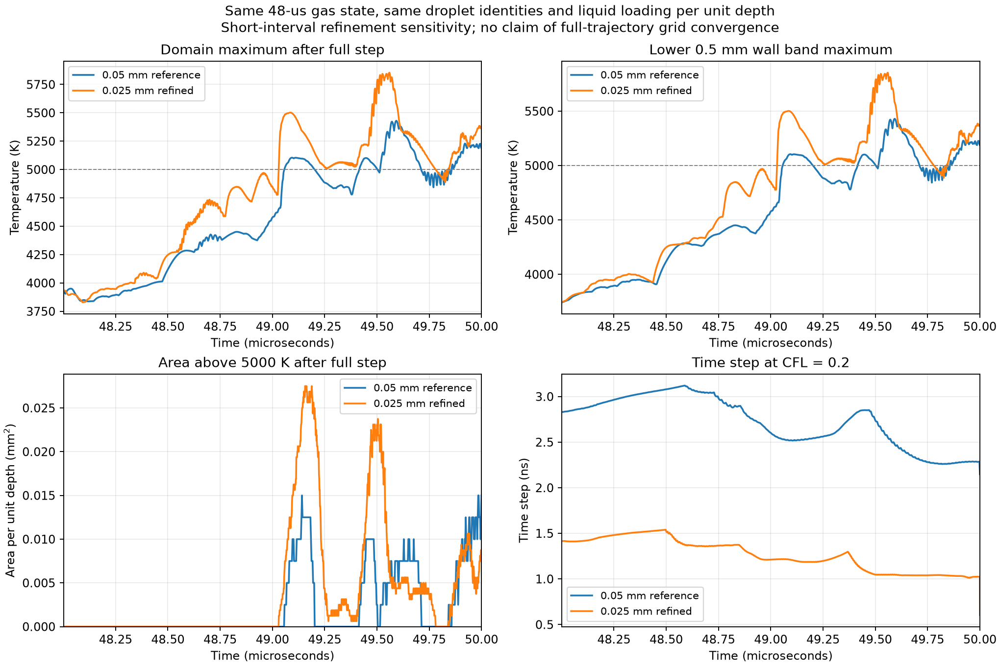
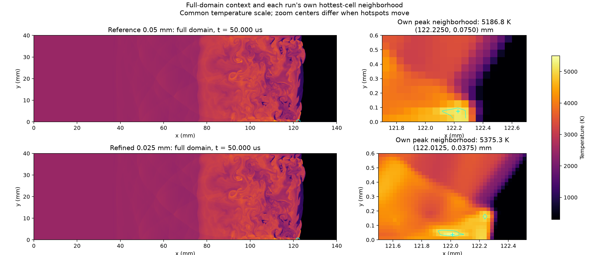
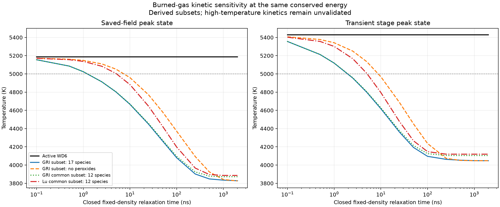

# 高温机理与加密网格复核报告

本轮完成了受控燃后气体有限速率测试、独立化学积分复核，以及保留原壁面条件的 0.025 mm 加密对照。**加密算例仍出现超过 5000 K 的温度，最高记录为 5854.05 K；新增的独立复算仍不支持把首次越限归因于化学积分误差。** 高温化学反馈不足值得优先处理，但本轮没有得到经过验证的完整机理替换方案，也没有完成物理修复。

## 1. 网格对照实际改变了什么

从同一个 48.001263565 μs 检查点出发，将 2800 × 800 网格加密为 5600 × 1600，间距由 0.05 mm 减至 0.025 mm；继续计算至 50 μs。物理区域、壁面、喷雾物性、化学参数和 CFL=0.2 相同。细网格使用两个 GPU。气相单元平均守恒状态采用分片常数延拓，每个父单元的四个子单元值相同，因此初始限制回父网格的误差为零。

该二维喷雾库使用 **Lz = Δx**，源项单元体积为 Δx·Δy·Δx。因此，细化时必须将每个 parcel 的 `number_density` 和 `num_dens0` 同时乘以 0.5，才能保持单位厚度的液体总量。液滴位置、身份、直径、速度、温度和组分不变。这里保持的是单位厚度负载，不能误写为实际 Lz 不变。

最初未缩放权重的 `fine_main_v1` 会改变液体负载，已主动停止并标为无效对照；其历史记录保留。以下结果只使用修正后的 `fine_main_depth_v2`。

验证包括：原网格检查点读写前后及推进 10 步后的气相和液滴状态对照通过 1e-12 相对容差；细网格重启时所有气相子单元与父单元一致，991652 个液滴身份一致，液滴强度量和预期权重变换误差均为零。重新沉积到网格上的单元 parcel 数和平均直径本来就依赖网格，不能要求它们逐子单元等于父单元；已另行核对总 parcel 数。

依据：[修正后的重启验收](fine_restart_depth_acceptance_v3.json)、[二维厚度与权重审计](checkpoint_refined_depth_v2_audit.json)、[输入参数对照](grid_input_comparison_v1.json)。

## 2. 加密结果

下表只比较共同的约 48–50 μs 区间。中间算子阶段的最大值与完整时间步后的最大值分开统计；面积是二维面积，即单位出平面厚度对应的高温区域尺度，不直接比较不同网格的超限单元数。

| 网格间距 / mm | 所有记录阶段的峰值 / K | 50 μs 完整步峰值 / K | 50 μs 超过 5000 K 的面积 / mm² | 时均超限面积 / mm² |
|---|---:|---:|---:|---:|
| 0.050 | 5430.18 | 5186.77 | 0.015000 | 0.002228 |
| 0.025 | 5854.05 | 5375.29 | 0.008125 | 0.004070 |

时均面积使用完整步末面积按实际 dt 加权的矩形积分。参考网格首次超限所在时间步为 **49.055593–49.058124 μs，输运/喷雾后**；细网格为 **49.029436–49.030652 μs，第一化学半步后**。这里给出包围算子阶段的完整时间步区间，不给分裂算子虚构独立的物理时刻。

细网格全程峰值位于 (119.33750, 0.01250) mm，记录阶段为输运/喷雾后。两组计算均完成至 50 μs，温度诊断中没有非有限值。末步可能因对齐 50 μs 而缩短，不应将这种单次缩短解释为时间步持续塌缩。

50 μs 时，参考与细网格的平均领先压力波前位置分别为 124.334164 和 124.279364 mm，相差 -0.054799 mm。定义均为每个横向截面中最下游的 3p0 压力交点。波前统计与局部温度峰值应分别判断。

这是一组从相同粗网格历史状态继续推进的短时加密敏感性试验，不能证明完整过程网格无关。CFL 固定时，空间和时间步同步细化；同时，同一批 parcel 在更小单元中的沉积分布会改变。完整收敛研究还需要控制 parcel 采样误差，并从更早时刻建立相应分辨率的轨迹。本次加密没有消除高温，不能把先前粗网格未超限视为已修复。

完整数据：[时间历史统计](grid_history_final_v1/summary.json)、[最终场统计](grid_final_fields_v1/summary.json)、[波前和单位厚度液体库存](grid_snapshot_metrics_v1/summary.json)。开放区域中的质量库存允许随出入口通量变化，这些库存统计不是质量守恒残差。

## 3. 首次越限是否为化学积分误差

细网格首次越限时，同一单元的四个阶段均有完整记录：

| 阶段 | 温度 / K |
|---|---:|
| 步首 | 4976.594315 |
| 第一化学半步后 | 5007.377216 |
| 输运和喷雾后 | 5004.200892 |
| 第二化学半步后 | 5034.105101 |

两个化学半步分别升温 30.782901 K 和 29.904209 K。独立 SciPy Radau 以两个化学反应进度积分当前正则化 WD6 模型，单独实现 NASA7 内能反算，并对齐主程序在热力学范围外使用的温度反算约定。两组 Radau 容差的温度结果差异小于 1e-9 K。

默认原生积分器与独立参考的最大温差为 **0.000125179 K**；实际流场阶段记录与独立参考的最大温差为 **0.001304287 K**。四档原生容差下的这 8 次复算全部返回成功。因此，这两个约 30 K 的升温不是本次所测化学积分误差造成的，主要是当前模型给出的反应结果。

该单元步首仍有正庚烷质量分数 0.005233，不能套用下一节仅针对燃后气体的惰性痕量燃料模型。首次越限与已经高度燃尽的最高温状态，也不能混作同一成因。以上为同一欧拉单元的算子记录，输运阶段的温差不能直接等同于某个物质团的压缩加热量。

依据：[首次超限完整阶段记录](fine_first_crossing_snapshot_v1.json)、[独立复算结果](fine_first_chemistry_validation_v1/validation.json)、[复算摘要](fine_first_chemistry_validation_v1/summary.json)。这验证的是当前模型的数值积分，不是其高温物理准确性。

计算完成后，还从细网格全程极值、末步和较大化学升温事件中提取了 8 对同单元匹配阶段进行复核。默认原生积分与独立参考的最大温差为 0.000125179 K，实际流场阶段记录与参考的最大温差为 0.001304287 K。该补充检查覆盖最终记录中的关键状态；非默认容差的单独成功/失败情况保留在[细网格最终化学复核](fine_hot_chemistry_final_v1/summary.json)中，不把失败的部分积分状态作为终点精度结果。

## 4. 高温反应网络会怎样改变燃后状态

从已有记录中选取残余正庚烷质量分数低于 1e-30 的 5 个燃后状态，保持记录密度、初始组成和守恒内能，执行封闭、定容、绝热有限速率松弛。另 2 个含可观残余燃料的状态被排除。新热力学的初始温度用守恒内能反算：两个峰值样本从 5186.77/5430.18 K 对应到 5174.27/5414.04 K；这十余 K 的变化与随后反应网络产生的降温分开处理。

4 个子机理 × 5 个样本 × 2 组积分容差，共完成 40 条轨迹；同时完成 65 个原生 WD6 对照。下表列出两个峰值样本的代表性结果。

| 模型 | 5187 K 样本，2.5 ns / K | 同样本，100 ns / K | 5430 K 样本，2.5 ns / K | 同样本，100 ns / K |
|---|---:|---:|---:|---:|
| 当前 WD6 | 5186.8 | 5186.8 | 5430.2 | 5430.2 |
| GRI 燃后 17 物种 | 4912.7 | 4079.6 | 4954.5 | 4095.5 |
| GRI 去过氧化物 15 物种 | 5109.5 | 4371.0 | 5250.0 | 4235.9 |
| GRI 公共 12 物种 | 4913.3 | 4094.7 | 4957.8 | 4124.9 |
| Lu 公共 12 物种 | 5083.6 | 4197.3 | 5167.0 | 4146.9 |

原生 WD6 在这两个峰值燃后状态上几乎保持原温度。四组高温子机理均预测降温，且这两个样本到 100 ns 时均低于 4400 K；但“2.5 ns 内降至 5000 K 以下”并不普遍。GRI/Lu 公共 12 物种对照使用相同热力学，仍表现出明显的早期速率差异。去掉 HO2/H2O2 后降温也显著放缓，说明不能把第一组 GRI 子集给出的纳秒时间尺度当作已验证物理常数。

这些受控计算表明，燃后高温反应网络对温度反馈的影响远大于本轮测得的化学积分误差。不过，实际流场还在持续输运、压缩和进行相间交换；不能从原流场温度中直接减去离线松弛的温差，声称已获得修正后的二维解。

依据：[有限速率原始结果](burned_gas_finite_rate_v3/result.json)、[不同动力学网络对照](burned_gas_kinetic_sensitivity_v1/result.json)、[反应通道诊断](burned_gas_finite_rate_v3/reaction_channel_diagnostics.json)。

## 5. 现在可以得出的结论与尚未完成的验证

1. 默认化学积分器在已检查的关键状态上能够复现独立参考；继续单纯收紧容差，不能替代物理模型验证。
2. 更细网格仍然出现高温，局部近壁峰值并未因这次加密消失；目前仍不能宣称网格收敛。
3. 高温反应网络选择对已燃高温状态的反馈非常重要，准确时间尺度却仍有动力学不确定性；完整模型必须同时保留正庚烷氧化和必要的高温反应通道。
4. 本轮没有将派生燃后子机理植入完整两相算例，也没有据此交付一个“高温已修复”的流场。所核查的完整正庚烷机理及其热力学范围，见[机理筛选与适用范围](机理筛选与适用范围.md)。

## 6. 原始文件保存与复核

修正后加密算例的全部原生输出已压缩并逐文件核对，共 40 个原生文件，压缩包大小 4.181 GB。持久存储位置：`/home/cj/my-pele/repair_validation/thermal_model_20260911/fine_main_depth_v2_native_v1.tar.gz`。

原生归档 SHA256：`fdf15ca7d0147873addef5a8dedbe250b2e90a9c738bc9023f9832ab319fdd92`。详细记录见[归档验收](fine_native_archive_v1.json)和[原生文件清单](fine_native_plot_manifest.json)。小型交付包包含报告、图表、逐步 CSV、实际输入、源码、命令和审计；大型原生场文件单独保存。旧算例及无效试验的记录保留，未混入本报告的有效对照统计。
