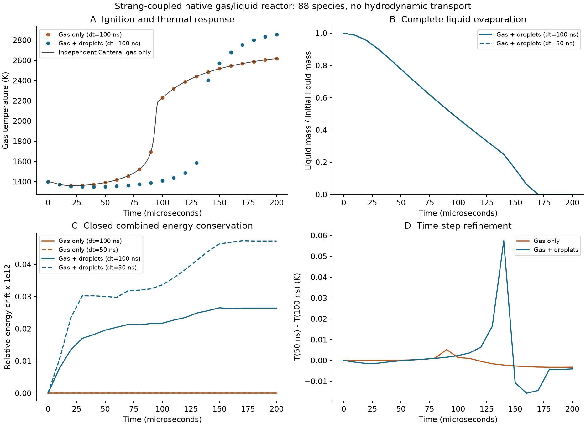
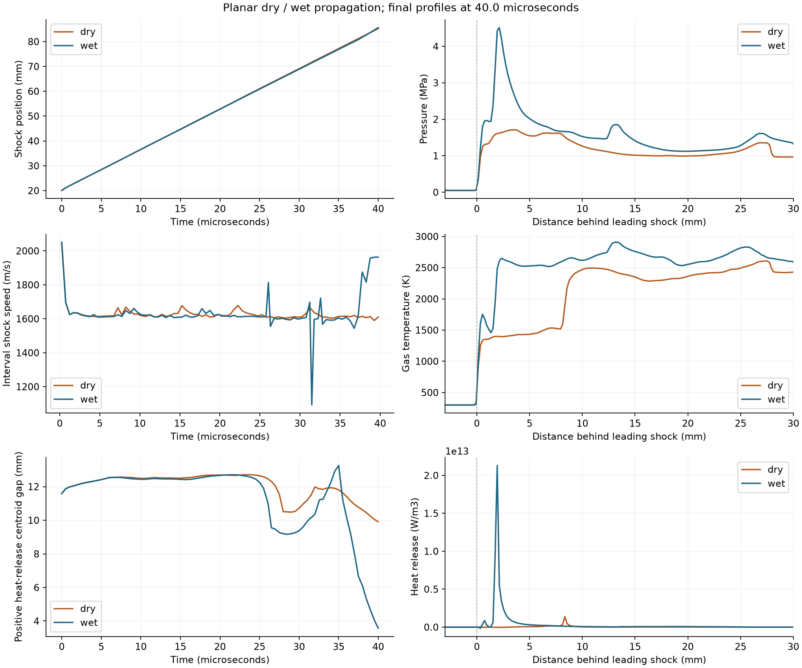
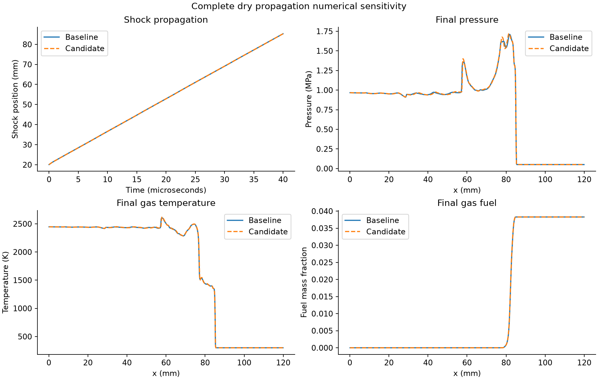
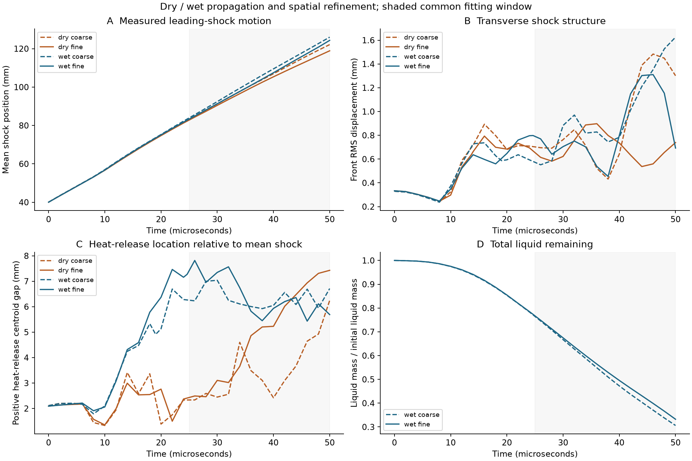
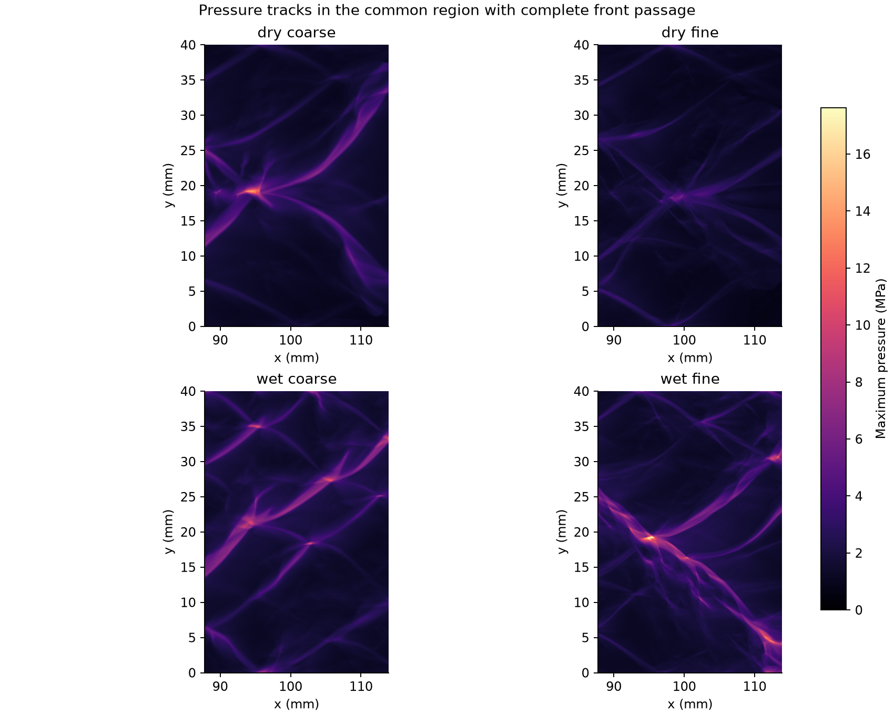
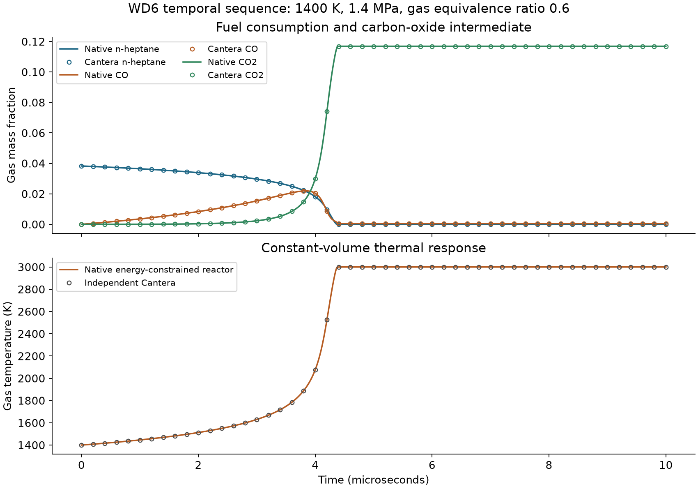
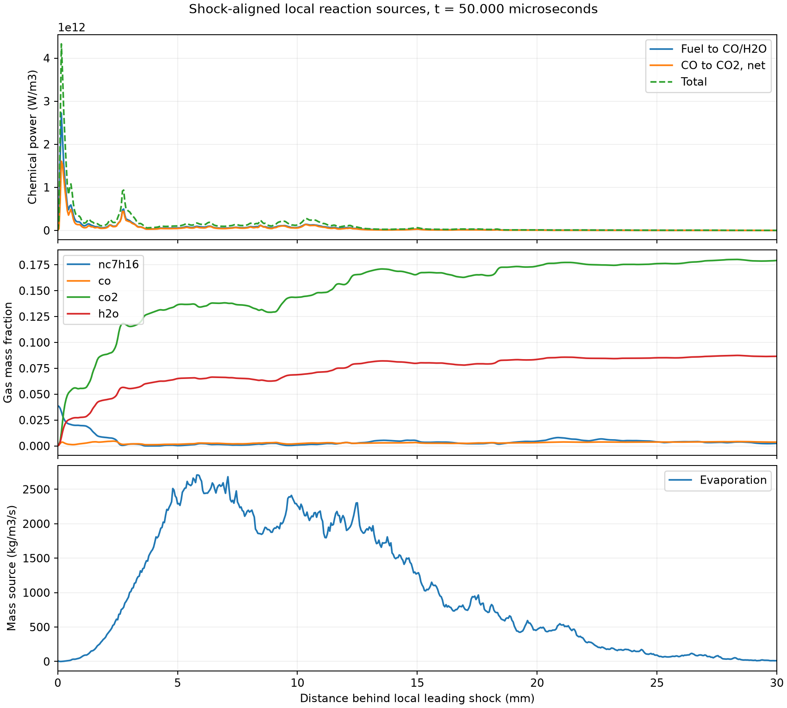

# 气液反应传播与验证证据

本报告对应 2026-09-10 的原生 PeleC 气液喷雾实现。88 组分干／湿一维算例均完成 40 微秒；独立 WD6 机理的干／湿、粗／细四组二维算例均完成 50 微秒。细网格湿态的 50 微秒保存场出现 6 个超过 5000 K 热力学拟合上限的单元，因此该终态包含热力学外推。下文区分数值完成、守恒验证、有限时间传播结果以及尚未建立的热力学范围内全程验证和稳态／网格收敛结论。

## 实现与物理设置

气相推进使用原生 PeleC 守恒流动与有限速率化学；液体由 Lagrangian 液滴表示，包含受热、蒸发和动量交换。气相的质量、动量和能量源项按液滴实际变化回写，完整蒸发后的液滴移除也计入预算。液相热量采用与气态燃料一致的参考焓和潜热基准。化学与流动／液滴更新使用 Strang 分裂；没有预设随时间移动的热源或强制波速。

上游气体为正庚烷／空气，300 K、0.5 atm，气相当量比 0.6；湿态另加 300 K、初始直径 10 μm 的液滴，液相当量比 0.4。二维域为 140 mm × 40 mm，网格分别为 1400 × 400 和 2800 × 800，横向滑移壁面。初始波面位于 40 mm 附近，并施加小幅多模扰动；液滴从扰动波面之外的 40.8 mm 开始分布。初始 ZND 波的速度为气相平衡 CJ 参考的 1.02 倍，后续波速由解自行演化。

88 组分／729 反应与六组分 WD6 是两套独立机理。二维胞格对照使用 WD6，不能称为 88 组分二维胞格计算。WD6 的分数反应级数在浓度趋零时经过显式记录的正则化，本次 ε=10⁻¹⁰ mol/m³；生成的反应率、Jacobian、原生反应器和独立参考均另有检查。正则化改变了耗尽附近的速率形式，不能称为逐字复现未修改的原始全局速率律。

二维主算例采用 CFL=0.2、WD6 单元化学积分 rtol=10⁻⁴、组分绝对容差 10⁻¹³。时间步与化学容差的二维早期联合对照仅覆盖早期传播，不能称为完整 50 微秒的独立时间步收敛。单／双 GPU 切换前，使用相同网格、相同保存状态进行短时对照，并逐 ID 核对全部液滴；正式续算使用原保存状态，而非性能测试的终态。

两种液体表示采用独立入口：解析界面的混合物 EOS／PLIC 见[界面模型报告](界面模型与标准验证.md)。同一液体质量不能同时计入体积分数与液滴粒子。

## 封闭系统守恒与化学核查

| 实际完成的 200 微秒算例 | 最大质量相对漂移 | 最大总能量相对漂移 | 最大元素相对漂移 |
|---|---:|---:|---:|
| 88 组分干态，ODE rtol=10⁻⁶ | 0 | 0 | 1.14e-14 |
| 88 组分湿态，ODE rtol=10⁻⁶ | 8.91e-15 | 2.75e-14 | 1.72e-13 |
| WD6 干态，GPU | 0 | 0 | 3.64e-14 |
| WD6 湿态，GPU | 3.04e-15 | 3.91e-15 | 1.18e-13 |
| 非反应湿态，初始滑移 10 m/s，Δt=0.1 μs | 1.24e-14 | 2.43e-14 | 1.56e-13 |
| 非反应湿态，初始滑移 10 m/s，Δt=0.05 μs | 1.7e-14 | 4.58e-14 | 3.16e-13 |

原生 88 组分反应器在 Δt=0.1／0.05 μs 下，与独立 Cantera 参考的最大采样温差分别为 0.2965／0.3017 K。两档时间步的干态最大采样温差为 0.00523 K，湿态为 0.05752 K。这是封闭反应器和相间交换验证，不替代传播算例的空间收敛。

非反应滑移算例验证了气、液两相之间的动量转移：两档时间步的总动量尺度化漂移均低于 4.8×10⁻¹³，燃料总量保持不变。生成器关闭化学反应时会移除不适用的 ODE 参数，严格的未使用参数检查保持启用。

## 88 组分一维传播：完整 40 微秒

| 量 | 干态 | 湿态 |
|---|---:|---:|
| 20–40 μs 位置拟合速度（m/s） | 1618.5713 | 1616.1429 |
| 末端波面位置（mm） | 85.2446 | 85.6340 |
| 末端全域最高温度（K） | 2607.2788 | 2907.8171 |
| 末端全域最高压力（MPa） | 1.7110 | 4.5130 |
| 末端正放热质心距平均前导激波（mm） | 9.9127 | 3.5697 |

湿态剩余液体质量约为初始值的 64.99%。其 38–40 μs 区间拟合速度增至约 1932.0 m/s，而干态同期约为 1604.3 m/s。湿态末期存在明显加速和强放热脉冲，不能仅凭后半程平均速度接近干态，就认定稳态或严格 CJ 传播。

全时段保存场的压力、密度、温度及液滴状态通过有效性检查，未出现非有限值；物种和误差低于检查限，88 组分热力学记录未超出其 300–3000 K 范围。曲线中的相邻输出速度受输出时间间隔和有限网格波面定位影响，特别是重启保存点附近的短间隔，不能直接视为每个求解时间步的真实瞬时波速。各重启接点均独立检查气相守恒场及逐 ID 液滴状态。

干、湿初始化采用相同的上游物理条件，参考 ZND 表分别生成，文件并非逐字节相同：最大温差约 6.80×10⁻⁶ K、压力差约 0.00613 Pa、物种质量分数差约 1.35×10⁻⁹。对比文件保存了两份表的哈希和实际差异。

## 时间步与化学容差敏感性

| 88 组分干态完整 40 μs 对照 | 后半程速度变化 | 末端波面位置差（mm） | 末端逐点最大温差（K） | 末端最大物种质量分数差 |
|---|---:|---:|---:|---:|
| CFL 0.1 → 0.05 | -0.037821% | -0.0040628 | 111.9159 | 0.0134447 |
| ODE rtol/atol：10⁻⁸/10⁻¹⁸ → 10⁻⁶/10⁻¹⁶ | +0.001130% | +9.42993e-05 | 1.6204 | 0.000212515 |

CFL 细化对平均速度影响很小，但陡峭反应区的逐点温度／组分差仍明显，因此本结果不宣称全部场量已时间步收敛。干态的完整容差对照、封闭反应器以及湿态短时重启对照支持当前所选容差的使用；尚未进行湿态完整 40 μs 的严格／宽松容差成对对照。

## WD6 二维传播与空间细化：完整 50 微秒

共同拟合窗口为 25–50 μs，实际使用各算例保存在该窗口内的时刻；两段子窗口用于识别后期加速或减速。速度来自前导压力跃升的位置拟合。

| 算例 | 25–50 μs 速度（m/s） | 25–37.5 μs 速度（m/s） | 37.5–50 μs 速度（m/s） | 末端波面 RMS（mm） |
|---|---:|---:|---:|---:|
| 干态，0.1 mm | 1557.99 | 1611.13 | 1527.34 | 1.3012 |
| 干态，0.05 mm | 1441.79 | 1523.29 | 1363.33 | 0.7388 |
| 湿态，0.1 mm | 1682.21 | 1719.99 | 1651.10 | 1.6256 |
| 湿态，0.05 mm | 1640.06 | 1600.55 | 1676.69 | 0.6927 |

以粗网格速度为分母，0.1 → 0.05 mm 的共同窗口平均速度变化为：干态 -7.459%，湿态 -2.506%。这是两档网格的观测敏感性，不是三网格外推误差或网格收敛指数。

| 50 μs 末端状态 | 平均波面位置（mm） | 全域最高温度（K） | 全域最高压力（MPa） | 正放热质心距平均激波（mm） |
|---|---:|---:|---:|---:|
| 干态，0.1 mm | 122.133 | 3152.49 | 3.2334 | 6.244 |
| 干态，0.05 mm | 118.900 | 3328.10 | 2.5062 | 7.428 |
| 湿态，0.1 mm | 126.006 | 4006.52 | 6.1220 | 6.712 |
| 湿态，0.05 mm | 124.334 | 5186.77 | 9.2592 | 5.690 |

细网格干态后期减速，同时平均波面至正放热质心的间距扩大。这是与“稳态且已网格收敛”相矛盾的实际证据。四组计算均完成预定区间与原始场检查，但不能将这一点等同于通过稳态胞格或网格无关性认证。

细网格湿态的后段拟合速度从约 1600.55 增至 1676.69 m/s；平均激波至放热质心的间距从 26 μs 时约 7.82 mm 减至终态约 5.69 mm，期间有波动。它与干态的后期演化不同，也不属于已经证明的稳态。

热力学范围检查发现：细网格湿态在最后一个保存场的最高温度为 5186.77 K，2,240,000 个单元中有 6 个超过 5000 K，体积占比 0.000268%，贡献当时全域正放热的 0.1705%。前一个约 48.001 μs 保存场最高温度为 3934.87 K，保存记录中首次超限在 50 μs；没有逐时间步温度极值记录，不能确定两次保存之间的首次超限时刻。少量单元不等于其传播影响可忽略。该终态不能标记为“全场处于热力学标定范围内”。[超限单元坐标、状态与组分](wet_fine_thermal_extrapolation_v1.json)保留了具体证据。

为量化最后保存点对速度拟合的影响，还对四组统一去掉首次记录超限时刻及之后的保存点，使用约 26–48 μs 的保存状态重新拟合。以下比较只反映拟合窗口敏感性，不能证明未保存时间步没有外推或重新验证外推热力学。

| 算例 | 原共同窗口速度（m/s） | 去掉末端超限时刻后的速度（m/s） |
|---|---:|---:|
| 干态，0.1 mm | 1557.99 | 1565.23 |
| 干态，0.05 mm | 1441.79 | 1453.24 |
| 湿态，0.1 mm | 1682.21 | 1685.63 |
| 湿态，0.05 mm | 1640.06 | 1633.51 |

压力轨迹按每个已完成的求解时间步累积最大压力，输出间隔仅控制写盘频率。重启后的累积从重启时刻重新开始，因此下图采用四组均包含完整波面通过记录的同一物理区间，并共用色标。交叉轨迹与横向波面变化可用于观察胞格样结构；自相关重复距离不自动等于收敛的胞格尺寸分布。

四组压力轨迹的共同裁剪区间为 x=87.760–113.900 mm。以下列出同一区间内、按记录的正相关峰门槛检出的重复距离；横向相关只检查到半域宽，因此不覆盖任意大的胞格。

| 算例 | 流向正相关峰对应距离（mm） | 横向正相关峰对应距离（mm） |
|---|---|---|
| 干态，0.1 mm | 未检出满足阈值的正峰 | 未检出满足阈值的正峰 |
| 干态，0.05 mm | 未检出满足阈值的正峰 | 未检出满足阈值的正峰 |
| 湿态，0.1 mm | 未检出满足阈值的正峰 | 未检出满足阈值的正峰 |
| 湿态，0.05 mm | 未检出满足阈值的正峰 | 未检出满足阈值的正峰 |

这些峰仅描述压力图样的重复性；未检出正峰不等于不存在横波，检出正峰也不等于已经获得稳定胞格宽度。流向窗口长度、重启后的记录长度与横向 40 mm 域宽均限制可作出的判断。

## 反应序列与局部波—反应耦合

在每个单元原始状态上重构燃料氧化与 CO 净氧化功率，并核对两者之和与原生放热率。随后将各横向列对齐到各自的局部前导激波再平均，避免先平均温度／组分后计算非线性反应率。以下量与“距横向平均波面”的全域质心不同。

| 50 μs 算例 | 燃料阶段峰值位置（mm） | CO 净氧化峰值位置（mm） | 总正放热质心（mm） | 激波后 5 mm 内正放热占比 |
|---|---:|---:|---:|---:|
| 干态，0.1 mm | 2.000 | 2.000 | 5.364 | 50.77% |
| 干态，0.05 mm | 1.500 | 1.500 | 7.098 | 40.14% |
| 湿态，0.1 mm | 0.400 | 0.500 | 4.987 | 64.16% |
| 湿态，0.05 mm | 0.150 | 0.150 | 4.919 | 60.35% |

上述两阶段存在显著重叠。空间上可分辨的峰值、质心和蒸发位置，是所选机理下的源项顺序及距离证据；它们没有标记燃料分子的原始气／液相来源，也不能单独证明独立的“接力爆轰”。

在独立的 1400 K、1.4 MPa 均匀 WD6 定容反应器中，原生计算的燃料半消耗、CO 峰值和 CO₂ 半最终生成时刻分别为 3.9602、3.8400 和 4.1477 μs；与 Cantera 的最大温差为 0.000552 K、最大质量分数差为 7.55e-08。这些是均匀反应器时间，不是爆轰流场的粒子停留时间。

## 外部基准及结论的适用范围

外部对照采用 Zhao 与 Zhang 的 ICLASS 2021 会议论文 [Numerical simulation of two-dimensional detonation propagation in partially pre-vaporized n-heptane sprays](https://arxiv.org/pdf/2103.12525)。其纯气 φ=0.6 数值结果给出 1657±323 m/s 的速度及 5–26 mm 的胞格范围；它们是数值结果，不是湿态实验误差带。原论文使用 1 m 长域，并先在 800 mm 气体段发展后进入液滴云；当前短域与 ZND 初始化的历史不同，液滴物性与正则化机理也有差别。[完整对照说明](../../examples/academic/spray_detonation/REFERENCE_COMPARISON.md)列出了这些差别。

本次独立平衡 Hugoniot 计算在气相当量比 0.6 下给出 88 组分 CJ 参考速度 1594.69 m/s、WD6 热力学平衡参考速度 1602.45 m/s。WD6 的经验 CO 正／逆反应率不严格满足热力学详细平衡，因此后一个数值不自动等于其有限速率动力学本征波速。

本轮已形成可运行的守恒气液反应求解、完整有限时段传播及可复核的源项／压力轨迹／网格敏感性证据。细网格湿态末端涉及局部热力学外推，仍需有依据的高温热力学模型与对应复算，才可形成该工况的全程热力学范围内验证；本轮没有通过更改上限标签来消除这一限制。结果不支持宣称网格无关的稳态胞格、自持接力爆轰或严格复现该论文。真实 CAD 和实际三维泄漏／火灾仍不在本轮范围。

## 复算与交付位置

- [构建、输入生成和所有分析命令](../../examples/academic/spray_detonation/README.md)
- [闭合系统原始预算检查工具](../../tools/validate_closed_spray.py)
- [逐 ID 液滴与气相重启检查工具](../../tools/validate_spray_restart.py)
- [完整四组比较数值](wd6_four_case_comparison_v2/comparison.json)
- [完整一维干湿比较数值](native88_planar_comparison_v2/comparison.json)
- [证据文件 SHA-256 清单](evidence_manifest.json)

实际源仓库为 `/home/cj/my-pele`，完整 AMReX 原始场和粒子记录保留在其 `repair_validation/twophase_20260910` 下。本地交付包括对应源文件副本、报告、图像、派生数值与哈希；它不是包含所有第三方依赖及原始大场文件的独立运行环境。
