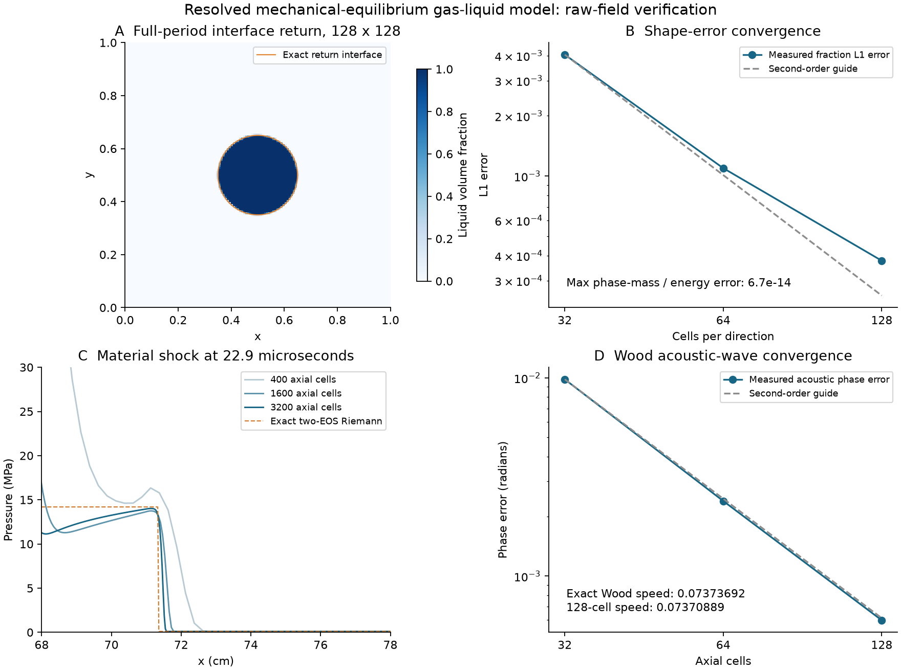

# 气液界面模型与标准验证

本说明对应 2026-09-10 已完成的 `resolved_twophase` 实现和 `v4` 验证结果。气液反应喷雾爆轰使用独立的 `spray_detonation` 入口，其传播结果另行汇总。

## 已实现的闭合与推进

求解器在原生 AMReX MultiFab 上推进气、液相质量，气相各组分质量，总动量，总能量及液相体积分数。两相共享压力和速度，分别恢复气相、液相温度；没有强制两相等温。气相组分质量分数以气相质量归一化。

气相采用 PelePhysics Fuego EOS，标准参考题也可选定比热比气体。液相采用含参考能偏置的 caloric stiffened-gas EOS。压力由两相内能之和与守恒总内能的一致性确定，纯气、纯液极限单独处理；声速采用 Wood 混合声速。液相体积分数方程包含机械平衡模型的压缩性项。

主时间步包含声学压力／速度更新和几何重映射。PLIC 的面扫掠体积同时用于相质量、气相组分、动量及能量交换；内部面的交换保持守恒。二维重构用 3×3 邻域拟合界面平面，三维几何采用 Youngs 法向。不合法的试算步被拒绝并缩短时间步，没有通过裁剪已完成状态的相质量或体积分数来掩盖错误。

## 已完成的定量验证

| 验证内容 | 网格／对照 | 实际结果 |
|---|---|---|
| 圆形界面完整周期平移 | 32²、64²、128² | 体积分数 L1 误差依次为 0.00404387、0.00109507、0.000377538；观测阶约 1.88、1.54 |
| 平移守恒与等压保持 | 同上 | 相质量与总能量相对误差低于 6.8×10⁻¹⁴，压力相对误差低于 2.4×10⁻¹¹ |
| Fuego 气体／液体有量纲接触面 | 完整 20 微秒周期 | 相质量和总能量误差低于 1.8×10⁻¹⁴，压力误差低于 2×10⁻¹¹ |
| 混合物小扰动声波 | 32、64、128 | 相位误差依次为 0.00982590、0.00239146、0.000598803 rad；传播速度向独立计算的无量纲 Wood 声速 0.0737369185 收敛 |
| 双 EOS 材料激波管 | 400、800、1600、3200 | 相对平均精确压力归一化的压力 L1 误差依次为 0.0105728、0.00676092、0.00429771、0.00265806；密度和速度误差也下降 |
| 并行及重启一致性 | 单／双 CPU 进程、连续／重启 | 最终存储场完全一致 |
| CPU／GPU 与双 GPU | 对应相同算例 | 单／双 GPU 场一致；CPU／GPU 守恒量最大相对差低于 9×10⁻¹¹，派生声速差低于 8×10⁻¹⁰ |
| 热力学和几何单元验证 | 480 个 Fuego／液体状态及独立几何对照 | 最终 CPU 构建的 CTest 通过；包括平面切割、扫掠体积分割和二维平面重构 |

激波管的体积分数误差受精确不连续面与点采样对齐影响，不随网格单调下降，因此本结果没有把它列为“已证明的体积分数收敛”。三维平面切割属于几何单元验证，并不等于完成了三维两相流应用验证。

最终验证工具已对三档界面平移、三档混合声波、四档材料激波管及 Fuego 接触面共 11 组完成场重新检查。工具同时核对进程退出状态和配置的物理终止时间；周期不完整或预算失败会返回非零状态。声波的参考 Wood 声速由输入的相体积模量独立计算，不从求解器输出的声速反推参考值。对应记录位于[最终复算检查](resolved_validation_final_cli_v1/execution.json)。

## 代码与复算入口

- [模型、构建命令及验证说明](../../examples/academic/resolved_twophase/README.md)
- [原生主推进](../../examples/academic/resolved_twophase/main.cpp)
- [机械平衡热力学闭合](../../src/academic/twophase/MechanicalEquilibriumEOS.H)
- [标准两相结果验证工具](../../tools/validate_resolved_two_phase.py)

实际运行仓库为 `/home/cj/my-pele`，原始结果位于其 `repair_validation/twophase_20260910` 下。此服务器版本链接到实际源仓库；本地交付包另含对应代码副本。

该入口的适用范围是均匀笛卡尔网格上的无黏可压缩机械平衡两相流，`amr.max_level=0`。它没有实现化学反应、相变、表面张力、黏性、重力、AMR 层级推进或 CAD 边界。液相参考参数属于所验证的数学 EOS，不能据此宣称完成了宽温度范围液体物性拟合。气液喷雾反应使用另一套液滴表示；同一份液体质量不得同时计入体积分数与喷雾粒子。
