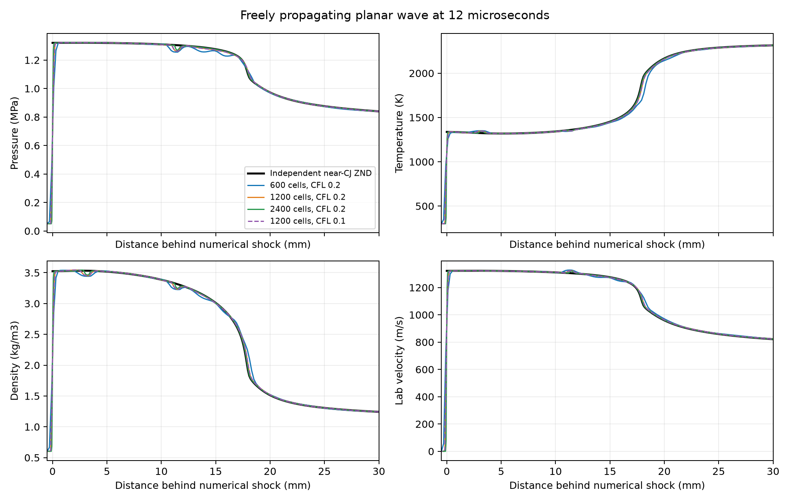
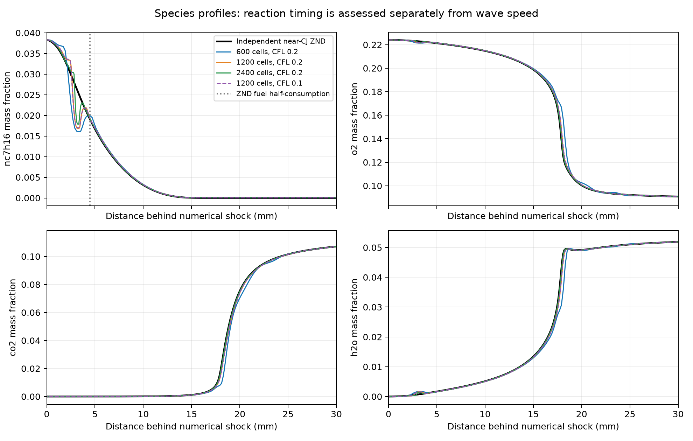
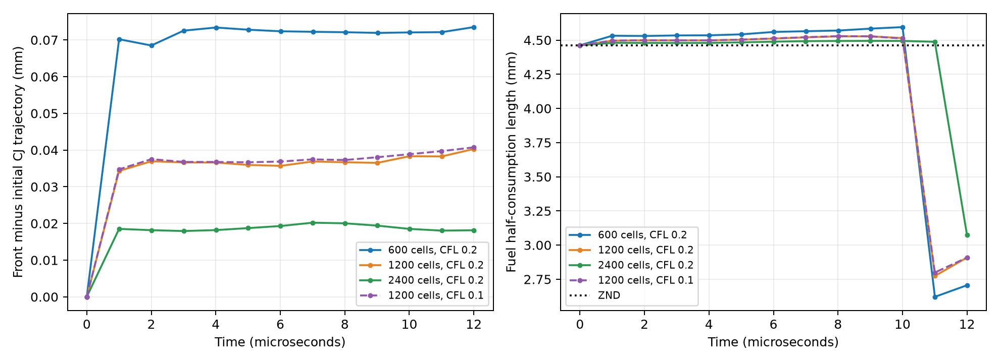

# 一维有限速率 ZND 算例验证

日期：2026-09-12。对象：现有 PeleC CPU 求解器、heptane_lu_88sk 机理、平面反应 Euler 方程。

## 结论与验证边界

**本次未满足全部预设比较指标；未通过项：细网格燃料首次半消耗距离。** 四个正式算例均以退出码 0 推进到 12 μs。2400 格最终平均波速为 1594.6279 m/s，相对热力学 CJ 参考速度的偏差为 -0.00382%。

本次实际验证的是：**用独立有限速率 ZND 解初始化后，现有求解器在短时自由传播中保持波速、流场及组分剖面的能力**。这是一个有网格和时间步比较的一维验证算例，不能据此宣布求解器已经获得完整物理认证。

它没有证明机理的动力学自持本征速度、长期自持性或线性/非线性稳定性；没有验证 WD6 高温化学、喷雾耦合、壁面、扩散、AMR 或 GPU 路径。预置波在 12 μs 内移动约 19.1 mm，但新进入波后的流体尚未走完整个主要放热过程：参考主升温中点的驻留时间约 61.17 μs。

## 物理条件与实际执行路径

- 未燃气：正庚烷/空气，φ = 0.6，T₀ = 300 K，p₀ = 50,662.5 Pa，初始实验室速度为 0。
- 机理：88 组分、729 反应。独立参考使用同一 YAML 的 Cantera 3.2.0，流场使用现有原生 C++ 机理及 CPU 二进制。
- 域：120 mm × 0.8 mm；初始激波在 x = 40 mm；横向周期且无扰动；两端 FOExtrap。
- 网格：600、1200、2400 个 x 向单元；y 向保留 2 行以满足现有 EB/网格实现约束。输出场横向差异为零；2 行与 4 行短步对照一致，因此这是二维程序承载的一维平面解。
- 反应 Euler：`pelec.do_hydro=1`、`pelec.do_react=1`；喷雾和各扩散项关闭；`amr.max_level=0`。
- 时间推进：本分支 Strang 分裂与原生 ReactorCvode，实际使用 `ode.rtol=1e-8`、`ode.atol=1e-18`。输入还保留了 `cell_chemistry_rtol=1e-7`、`cell_chemistry_atol_y=1e-14`，但源码确认这两个值仅传给另一条 WD6 外推积分分支，在本次 CVODE 路径不起控制作用。早期元数据的 `rtol/atol_y` 字段记录的是这两个输入值，不能解释为本次实际 CVODE 容差；单独的执行路径核查记录给出正确含义。
- 每个正式算例 24 个 MPI 进程；1 μs 间隔输出原生 plotfile，终点 12 μs。1200 格比较 CFL 0.2 与 0.1；尚未在 2400 格独立完成时间步收敛序列。
- 初值波速 D = 1594.70478764 m/s，即热力学 CJ 参考速度的 1.00001 倍。该比例只是相对热力学参考值，不能直接称为相对真实动力学 CJ 的过驱度。初始化后没有固定波前或施加波速。

## 独立参考解及 CJ 表述修正

热力学平衡 Hugoniot 上的最小波速为 **1594.68884075 m/s**。平衡声速与波后相对速度的相对差为 2.339e-08，证明热力学 CJ 极小值的数值求解自洽。

但不能把这一数值自动当作 heptane_lu_88sk 的精确动力学本征值。该机理只有 11 个显式可逆反应，其余包含分别拟合的正、逆向反应对。直接把热力学 CJ 状态代入该机理后，初始最大 |dY/dt| 为 115.417 s⁻¹；恒容绝热演化 1 ms 后温度变化 +0.185838 K，说明严格详细平衡并不成立。先前将其描述为严格可逆详细机理的表述已修正，原始元数据及修正说明保留在证据中，数值剖面和运行输入没有因此改动。

有限速率参考则直接积分稳态反应 Euler/ZND 方程。令 w = D−u，在激波坐标下满足 m = ρw、p + ρw² = 常数、h + w²/2 = 常数；组分按 dY/dτ = Wω̇/ρ 演化，距离按 dx/dτ = w 演化。冻结激波关系给出 von Neumann 状态后，使用 BDF 积分，不通过调整流场数值结果来拟合参考。

- von Neumann：p = 1.32077311 MPa，T = 1336.894521 K，ρ = 3.52418548 kg/m³。
- 参考质量、动量、能量最大相对残差分别为 4.734e-16、3.239e-13、7.287e-09。
- BDF 相对容差从 2e-9 收紧为 2e-10 后，1–15 mm 内温度最大差 1.004e-06 K，压力最大差 3.104e-04 Pa。
- 燃料半消耗距离 **4.461511 mm**；主升温中点 **17.818326 mm**，对应温度 1833.989535 K。均在导出参考剖面上线性插值；早期 4.47434 mm 是首个越过阈值的采样点，正式比较采用插值后的距离。
- 参考积分到物质驻留时间 100 μs，长度约 47.07 mm。其末端仍不是热力学 CJ 平衡态，不能将有限尾端强称为精确平衡区。
- 原始参考积分有约 1e-13 量级的微小负组分；导出使用 Cantera 归一化组成。相关原始负值和守恒检查均保留。

CJ/冻结激波/有限速率 ZND 的方法框架可参见 [Caltech SDToolbox 说明](https://shepherd.caltech.edu/EDL/PublicResources/sdt/)。本次使用自编 Cantera/SciPy 脚本，未声称运行了 SDToolbox 程序。

## 测量方法

以数值压力首次向未燃气侧降过 (p₀+pVN)/2 的最右交点定位激波，线性插值获得波前位置；按各算例自己的激波对齐剖面。主要波速拟合区间为 4–12 μs，同时报告 0–12、8–12 μs 拟合作为敏感性检查。

保留原先设定的激波后 1–15 mm 指标，另补充 1–30 mm 区间，覆盖主要升温及产物生成区。归一化 L1 为平均绝对误差除以固定参考尺度：压力 pVN−p₀、密度 ρVN−ρ₀、温度参考最大值−300 K、速度初始 D。它们不是逐点相对误差；激波跳跃区另列峰压误差。组分误差是质量分数的绝对差。

燃料半消耗距离采用从激波向下游走时第一次穿过 0.5Yfuel,0 的位置，因此会对局部非单调低谷敏感。粗网格的早期对齐误差与后期燃料低谷都保留，没有用重新选阈值、后一次交点或减去初值误差来改善评分。

## 正式结果

| x 向网格 | Δx / mm | CFL | 波速 / m·s⁻¹ | 相对热力学 CJ / % | 燃料半消耗 / mm | 半消耗长度误差 / % |
| --- | --- | --- | --- | --- | --- | --- |
| 600 | 0.200 | 0.2 | 1594.6635 | -0.00159 | 2.70603 | -39.347 |
| 1200 | 0.100 | 0.2 | 1595.1484 | +0.02882 | 2.90867 | -34.805 |
| 2400 | 0.050 | 0.2 | 1594.6279 | -0.00382 | 3.07300 | -31.122 |
| 1200 | 0.100 | 0.1 | 1595.1986 | +0.03197 | 2.90825 | -34.815 |

### 包含主要放热区的 1–30 mm 补充比较

| 网格 / CFL | p 的归一化 L1 / % | T / % | ρ / % | u / % | 主升温中点 / mm |
| --- | --- | --- | --- | --- | --- |
| 600 / 0.2 | 0.5615 | 0.6388 | 0.7925 | 0.3459 | 18.22487 |
| 1200 / 0.2 | 0.1925 | 0.2112 | 0.3069 | 0.1162 | 17.92313 |
| 2400 / 0.2 | 0.0718 | 0.0745 | 0.1324 | 0.0411 | 17.85058 |
| 1200 / 0.1 | 0.2194 | 0.2321 | 0.3299 | 0.1298 | 17.92209 |

### 原先设定的 1–15 mm 比较

| 网格 / CFL | p / % | T / % | ρ / % | u / % | 燃料 Y 的平均绝对误差 |
| --- | --- | --- | --- | --- | --- |
| 600 / 0.2 | 0.6643 | 0.2837 | 0.8224 | 0.2296 | 0.0012892 |
| 1200 / 0.2 | 0.2607 | 0.1326 | 0.3885 | 0.0899 | 0.00076942 |
| 2400 / 0.2 | 0.1078 | 0.0634 | 0.1856 | 0.0370 | 0.000387199 |
| 1200 / 0.1 | 0.2794 | 0.1375 | 0.4049 | 0.0970 | 0.000775071 |

### 网格趋势与时间步敏感性

| 指标（绝对误差） | 600 | 1200 | 2400 | 是否随加密严格下降 |
| --- | --- | --- | --- | --- |
| speed_error_percent | 0.00159078 | 0.0288205 | 0.0038229 | 否 |
| fuel_half_error_percent | 39.3472 | 34.8052 | 31.122 | 是 |
| p_L1_percent | 0.664293 | 0.260655 | 0.107823 | 是 |
| T_L1_percent | 0.283656 | 0.132591 | 0.063414 | 是 |
| rho_L1_percent | 0.822361 | 0.388519 | 0.185601 | 是 |
| u_L1_percent | 0.229637 | 0.089899 | 0.0370033 | 是 |
| Y_fuel_MAE | 0.0012892 | 0.00076942 | 0.000387199 | 是 |

网格趋势按实际结果列出；仅有阈值满足或某一平均波速非常接近参考，不等于已经进入渐近收敛区。燃料局部低谷、主升温位置和积分误差必须一起判断。

1200 格将 CFL 从 0.2 减半到 0.1 后：

| 指标 | CFL 0.1 − CFL 0.2 |
| --- | --- |
| speed_m_s | +0.05016159 |
| fuel_half_mm | -0.0004165498 |
| p_L1_percent | +0.01874026 |
| T_L1_percent | +0.004932539 |
| rho_L1_percent | +0.01633121 |
| u_L1_percent | +0.007087671 |
| Y_fuel_MAE | +5.651233e-06 |

时间步对照采用不同 MPI 单元分配策略以提高运行效率。额外 12 步 SFC/ROUNDROBIN 对照的 183 个唯一输出字段逐值完全相同，排除了该短步测试中分配策略的数值差异；它不替代完整精细网格时间收敛验证。

1200 格减半时间步后，燃料首次半消耗距离只变化 -0.4165 μm，明显不足以消除约 1.55 mm 的偏差。因此，在这组时间步范围内，单纯减小时间步不能解决该局部低谷。尚不能据此确认具体空间离散项或初始化步骤就是唯一原因。

### 守恒与运行完整性

| 网格 / CFL | 质量通量闭合残差 | 总能量通量闭合残差 | max |ΣY−1| | 最终 Tmax / K |
| --- | --- | --- | --- | --- |
| 600 / 0.2 | 4.988e-09 | 1.846e-07 | 1.843e-14 | 2346.302 |
| 1200 / 0.2 | 3.172e-09 | 1.846e-07 | 4.130e-14 | 2346.266 |
| 2400 / 0.2 | 2.151e-09 | 1.847e-07 | 5.307e-14 | 2346.249 |
| 1200 / 0.1 | 2.325e-09 | 1.851e-07 | 4.041e-14 | 2346.266 |

质量和总能量不是封闭域常量。表中残差是全域库存变化减去左右边界净通量时间积分，再除以初始库存绝对值；边界通量用约 1 μs 输出做梯形积分，因此这是采样通量闭合检查，不能当作每一步离散守恒的精确残差。全部正式输出场有限，横向差异为零。

### 预设指标判定

| 检验项 | 结果 |
| --- | --- |
| 热力学 CJ 声速条件 | 满足 |
| 参考解能量守恒 | 满足 |
| 细网格平均波速 | 满足 |
| 细网格流场平均误差 | 满足 |
| 细网格主要组分平均误差 | 满足 |
| 细网格燃料首次半消耗距离 | 未满足 |
| 全部输出场有限 | 满足 |
| 组分质量分数和 | 满足 |
| 全部正式算例正常完成 | 满足 |

原始阈值见 [validation_scope.json](validation_scope.json)，完整指标见 [results/assessment.json](results/assessment.json) 与 [results/metrics.csv](results/metrics.csv)。1–30 mm 和主升温中点为追加诊断，没有替换原始阈值。

## 失败探针与保留的限制

- 单行 y 网格探针在 EB 初始化阶段退出码 6；它是实现约束触发的运行失败，不计物理通过。
- 旧 88 组分 GPU 二进制在 `SUNLinSol_dense_custom()` 初始化返回空指针，退出码 6；本次正式矩阵使用 CPU，不计 GPU 通过。
- 600 格终点燃料出现局部低谷，使第一次半消耗位置提前。其原因尚不能仅凭这次短时结果定为真实物理不稳定；图中保留网格、时间步与时间历史，供进一步区分初始化误差与数值反应耦合。
- 12 μs 小于参考燃料半消耗驻留时间约 16.39 μs，也明显小于主要升温驻留时间约 61.17 μs。因此大量下游结构仍来自预置波，下一阶段若要证明长期自持，需要更长传播、合适的边界和动力学本征速度分析。

## 复现与证据

服务器目录：`/home/cj/my-pele/repair_validation/znd_20260912`。原生场最初写在 `/dev/shm/my_pele_znd_20260912`，完整正式 plotfile 另打包并下载持久保存。

脚本依次为 `generate_znd_reference.py`、`launch_znd_case.py`、`analyze_znd_case.py`、`reference_characteristics.py`、`aggregate_znd.py`、`write_znd_report.py`。每个算例保存 inputs、命令、二进制/剖面/input SHA-256、原始日志、退出码、时间记录、原始 plotfile 与派生剖面。源码快照单独记录当前关键源文件哈希。

命令中的服务器路径依赖本项目布局。迁移运行时须调整路径并使用新算例目录；不要复用或覆盖已有 run。
